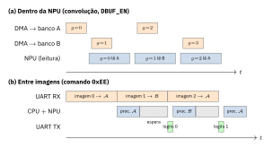
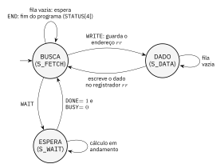

# Memórias e controle

Enquanto o controlador (`npu_controller.vhd`) decide **quando** cada coisa acontece, o caminho de dados (`npu_datapath.vhd`) define **como** os dados trafegam entre as memórias locais, o núcleo, as PPUs e a FIFO de saída.

## Memórias locais (*scratchpads*)

Para não buscar pesos e ativações na memória principal a cada uso, a NPU tem duas memórias locais de porta dupla (`ram_dual`):

1. **RAM de pesos:** os parâmetros aprendidos;
2. **RAM de ativações:** as entradas da camada corrente.

Uma porta de cada memória fica com a interface MMIO, para a escrita pelo hospedeiro, e a outra com o controlador, que alimenta o arranjo a uma palavra por ciclo durante o cálculo.

!!! abstract "Princípio da localidade"
    As memórias locais exploram a localidade dos dados: o que já está dentro da NPU é reaproveitado por vários *tiles* sem voltar a atravessar o barramento do sistema.

Além delas, o caminho de dados reúne:

- **Bases de região** (`W_BASE` e `I_BASE`): dividem as memórias em regiões, para que os pesos de cada camada fiquem residentes na sua própria região;
- **Memória de pesos em bancos** (`wgt_mem_banked`): no modo GEMV, a RAM de pesos é organizada em 4 bancos e entrega 16 pesos por passo, um para cada PE;
- **Memória de imagem do *im2col*:** 4 cópias da imagem crua, uma por linha do arranjo, que substituem a RAM de ativações na convolução (ver [Movimentação de dados](movimentacao-dados.md#im2col-em-hardware-npu_im2col));
- **Banco de vieses:** 8 vetores de 4 colunas, selecionados por *tile*.

### *Double buffering* (*ping-pong*)

Com um único banco, a mesma região é usada para a escrita pelo hospedeiro e para a leitura pelo núcleo, e o hospedeiro precisa esperar o fim de um *tile* antes de carregar o seguinte: a movimentação de dados fica em série com o cálculo.

Quando o IP é gerado com o *generic* `DOUBLE_BUFFER => true`, cada memória é duplicada em dois bancos físicos (A e B). A cada `START` com o bit `DBUF_EN`, o controlador troca os bancos: passa a ler o que acabou de ser preenchido e libera o outro para a próxima escrita, que pode acontecer mesmo com a NPU ainda ocupada. Assim, a carga do *tile* seguinte se sobrepõe ao cálculo do atual.

<figure class="ax-figura" markdown>
  { width="600" }
  <figcaption>(a) <em>Double buffering</em> dentro da NPU: enquanto o arranjo lê um banco, o DMA preenche o outro, e os papéis se invertem a cada <code>START</code> com <code>DBUF_EN</code>. (b) O mesmo princípio entre imagens, no <em>firmware</em> (comando <code>0xEE</code>): a recepção da próxima imagem pela UART se sobrepõe ao processamento da atual.</figcaption>
</figure>

!!! info "Retrocompatibilidade"
    `DOUBLE_BUFFER` vale `false` por padrão, o que preserva a estrutura e o consumo de BRAM da versão de banco único. Mesmo com o *generic* ligado, se o software nunca usa `DBUF_EN` (bit 8 de `CMD`), a NPU permanece no banco 0 e se comporta como a versão original.

## Da saída do arranjo à FIFO

A saída do arranjo é um vetor com os acumuladores das quatro colunas. Um `generate` instancia uma PPU por coluna, cada uma com a sua fatia do acumulador e o seu viés. No modo GEMV, as quatro somas parciais de cada coluna são **reduzidas** antes da PPU.

Depois da quantização, os resultados entram numa fila circular (`fifo_sync`) de 256 palavras, que desacopla o cálculo da leitura pela CPU. O **formatador de saída** (`OUT_CFG`) pode entregar as linhas na ordem 0 a 3 (por padrão, a drenagem começa pela linha 3), desempacotá-las em uma ativação por palavra ou, com `LOOP`, escrevê-las de volta na RAM de ativações, para que a camada seguinte as leia sem passar pela memória principal.

## Controlador

O controlador (`npu_controller.vhd`) é o micro-sequenciador da NPU: uma máquina de quatro estados (`IDLE`, `COMPUTE`, `DRAIN` e `FLUSH`) que traduz os comandos de alto nível em sinais de controle ciclo a ciclo.

### `IDLE`

Estado de repouso. Ao receber o `START`, a máquina captura a configuração da execução (número de passos `CONFIG`, número de *tiles*, modo) e, se pedido, volta os ponteiros de leitura às bases das regiões. Com *double buffering* e `DBUF_EN`, é neste instante que os bancos são trocados.

### `COMPUTE`

A cada ciclo em que os dados estão disponíveis, o controlador emite uma leitura das memórias de pesos e de ativações e avança os ponteiros; com *streaming*, uma leitura só é emitida quando o seu dado já foi escrito. Emitidas as $K$ leituras do *tile*, o controlador espera a latência do *pipeline* (leitura da BRAM, registro de entrada do núcleo e o *skew* do arranjo, 11 ciclos) para que os últimos dados atravessem o arranjo. Se o comando pede para não drenar (sinal `cmd_no_drain`), a máquina volta a `IDLE` preservando os acumuladores, o que permite somar vários blocos de $K$ no mesmo resultado; caso contrário, avança para `DRAIN`. No modo encadeado (`OVERLAP`), os *tiles* seguem um após o outro sem passar por `DRAIN`, e a máquina vai direto a `FLUSH` depois da última leitura.

### `DRAIN` e contrapressão

Na drenagem, o controlador emite `acc_dump` por $R=4$ ciclos: os acumuladores descem uma linha por ciclo até as PPUs, e a linha 3 sai primeiro. Cada ciclo de drenagem gera na FIFO uma palavra de 32 bits, com um byte por coluna, e deixa os acumuladores zerados para o *tile* seguinte. A drenagem só começa quando a FIFO comporta o *tile* inteiro: se a CPU não estiver lendo rápido o suficiente, as somas ficam guardadas nos PEs até haver espaço. Se ainda restam *tiles*, a máquina volta a `COMPUTE`, com os ponteiros retornando às bases conforme `RW_W` e `RW_I`.

### `FLUSH`

Antes de sinalizar `DONE`, a máquina espera os últimos resultados atravessarem a redução GEMV, a PPU e a FIFO (no modo encadeado, somada à latência do arranjo, porque o último *tile* ainda está saindo dele).

### Extensões do controlador

O controlador também implementa os mecanismos de [movimentação de dados](movimentacao-dados.md):

- **Sequenciador de *tiles*:** um `START` executa `TILES[15:0]` *tiles*, com retorno opcional dos ponteiros às bases (`RW_W`, `RW_I`) e troca do vetor de viés por *tile*;
- **Interlocks de *streaming*:** com `STREAM_I` ou `STREAM_W`, cada leitura só é emitida quando o seu dado já foi escrito na memória local, e o cálculo avança junto com a carga;
- **Tiles encadeados:** com `OVERLAP`, o fim de cada *tile* é marcado nas ativações, e o retorno dos ponteiros é aplicado na emissão seguinte, sem esvaziar o arranjo;
- **Modo GEMV:** gera o endereçamento dos 4 bancos de pesos e o atraso por PE.

## Processador de comandos

Com os dados resolvidos pelos [mecanismos de movimentação](movimentacao-dados.md), o custo que sobra é o do **controle**. Cada camada precisa de uma dúzia de escritas de configuração (bases das memórias, geometria do *im2col*, número de passagens, modo, quantização) e de um disparo, seguido da espera pelo fim do cálculo. Feita pela CPU, cada escrita custa dezenas de ciclos de instruções e de barramento, e a espera exige consultar o registrador de estado repetidas vezes.

O processador de comandos (`npu_cmd_proc.vhd`) tira esse trabalho da CPU: em vez de escrever os registradores, ela entrega à NPU um **programa** que os escreve.

### Instruções

O programa é uma sequência de palavras de 32 bits com três instruções, distinguidas pelos 4 bits mais altos. A instrução `WRITE` ocupa duas palavras, o cabeçalho com o endereço do registrador e o dado, e pode escrever qualquer registrador de configuração, inclusive o de comando, que dispara o cálculo.

| Instrução | Palavras | Efeito |
|---|---|---|
| `WRITE` | `0x1000_00rr`, dado | escreve o dado no registrador de endereço `rr` |
| `WAIT` | `0x2000_0000` | espera o cálculo disparado terminar (`DONE` e não `BUSY`) |
| `END` | `0x3000_0000` | fim do programa (bit 4 do registrador de estado) |

### Execução

As palavras chegam pela porta `DESC` e entram numa fila de 128 posições, de onde a máquina de estados as consome. No estado de busca, ela retira um cabeçalho da fila: se for um `WRITE`, guarda o endereço e vai ao estado de dado, onde retira a palavra seguinte e a escreve no registrador; se for um `WAIT`, vai ao estado de espera e só volta à busca quando o controlador indica que o cálculo terminou; se for um `END`, sinaliza o fim do programa. Palavras desconhecidas são ignoradas.

<figure class="ax-figura" markdown>
  { width="420" }
  <figcaption>Máquina de estados do processador de comandos. Cada <code>WRITE</code> passa pelo estado de dado; cada <code>WAIT</code> prende o programa até o fim do cálculo disparado.</figcaption>
</figure>

Três regras garantem que nada se perca:

1. Com a fila cheia, a escrita na porta `DESC` **segura o barramento** até abrir espaço.
2. Enquanto um programa executa, escritas de configuração vindas do barramento esperam o programa terminar, mas as portas de dados continuam livres, para que a imagem chegue durante o cálculo.
3. Uma leitura da porta de saída espera o próximo resultado, de modo que a CPU pode ler os *logits* sem consultar o estado.

### Exemplo: a CNN do MNIST

No *firmware* do SoC, o programa da rede inteira é uma constante, montada uma única vez na RAM. A macro `D_WR` gera as duas palavras de um `WRITE`, e cada linha do código é uma instrução, com o seu mnemônico no comentário. O programa tem 53 palavras, que cabem inteiras na fila, em três partes:

1. **Convolução:** quantização da PPU com ReLU, região dos pesos, geometria do *im2col*, $K=9$, 43 passagens encadeadas com saída na memória de ativações e cálculo durante a chegada da imagem; em seguida, dispara o cálculo e espera o fim.
2. **Camada densa:** reconfigura apenas o que muda: sem ReLU, ativações lidas da memória, modo GEMV, $K/4=169$ passos e três blocos, cada um com o seu viés.
3. **Epílogo:** devolve os modos ao padrão e zera o ponteiro de escrita da imagem, preparando a próxima inferência.

```c
#define D_WR(reg, val) (0x10000000u | (reg)), (uint32_t)(val)  // WRITE: 2 palavras
#define D_WAIT         0x20000000u                             // WAIT
#define D_END          0x30000000u                             // END

static const uint32_t cnn_prog[] = {
  // ---- Convolução 3x3, passo 2, 4 filtros, ReLU ------------------------------
  D_WR(0x44, 1),                 // WRITE QUANT_MULT, 1    ; PPU: M = 1
  D_WR(0x40, 8),                 // WRITE QUANT_CFG, 8     ; PPU: S = 8 (divide por 256)
  D_WR(0x48, 1),                 // WRITE FLAGS, RELU      ; PPU: liga a ReLU
  D_WR(0x20, W_CONV_BASE),       // WRITE W_BASE, conv     ; região dos pesos da Conv
  D_WR(0x24, 0),                 // WRITE I_BASE, 0        ; saída no início da RAM de ativações
  D_WR(0x2C, IM2COL_GEOM),       // WRITE IM2COL_GEOM      ; 28x28, 13 janelas/linha, passo 2, 3x3
  D_WR(0x30, 169),               // WRITE IM2COL_NWIN, 169 ; total de janelas
  D_WR(0x28, 1),                 // WRITE IM2COL_EN, 1     ; ativações vêm do im2col
  D_WR(0x08, 9),                 // WRITE CONFIG, 9        ; K = 9 passos por passagem
  D_WR(0x34, 43|RW_W|(3<<19)),   // WRITE TILES            ; 43 passagens, relê pesos, viés no banco 3
  D_WR(0x38, ORDER|LOOP),        // WRITE OUT_CFG          ; saída em ordem, na RAM de ativações
  D_WR(0x3C, STREAM_I|OVERLAP),  // WRITE MODE             ; calcula enquanto a imagem chega
  D_WR(0x04, 0x36),              // WRITE CMD, START       ; zera acumuladores e ponteiros; dispara
  D_WAIT,                        // WAIT                   ; espera a Conv terminar
  // ---- Densa 676 -> 10, modo GEMV --------------------------------------------
  D_WR(0x40, 8),                 // WRITE QUANT_CFG, 8     ; PPU: S = 8
  D_WR(0x48, 0),                 // WRITE FLAGS, 0         ; PPU: sem ReLU (logits)
  D_WR(0x28, 0),                 // WRITE IM2COL_EN, 0     ; ativações vêm da RAM (saída da Conv)
  D_WR(0x20, W_FC_BASE),         // WRITE W_BASE, densa    ; região dos pesos da densa
  D_WR(0x38, 0),                 // WRITE OUT_CFG, 0       ; saída na FIFO, lida pela CPU
  D_WR(0x3C, GEMV|OVERLAP),      // WRITE MODE             ; 4 linhas repartem as entradas
  D_WR(0x08, 676/4),             // WRITE CONFIG, 169      ; K/4 passos por bloco
  D_WR(0x34, 3|RW_I|BIAS_TILE),  // WRITE TILES            ; 3 blocos, relê entradas, viés por bloco
  D_WR(0x04, 0x36),              // WRITE CMD, START       ; dispara
  D_WAIT,                        // WAIT                   ; espera a densa terminar
  // ---- Epílogo: prepara a próxima imagem -------------------------------------
  D_WR(0x3C, 0),                 // WRITE MODE, 0          ; volta ao modo normal
  D_WR(0x34, 0),                 // WRITE TILES, 0         ; uma passagem por disparo
  D_WR(0x04, 0x80),              // WRITE CMD, RST_WR_I    ; zera o ponteiro de escrita da imagem
  D_END,                         // END                    ; fim do programa
};
```

A cada inferência, a CPU envia esse programa por DMA para a porta `DESC`, em 264 ciclos, e não escreve mais nenhum registrador da NPU. O código completo está em `fpga/sw/server/cnn_server.c`, no repositório do [SoC RISC-V](https://github.com/RISC-V-Azedinha/RISC-V).
