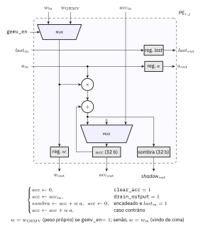
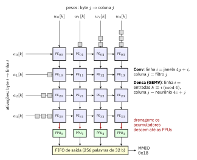
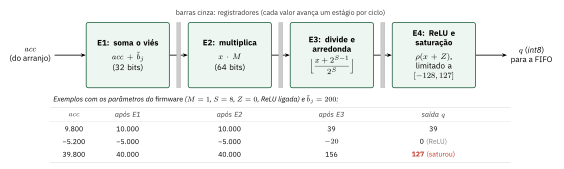

# Núcleo de cálculo

O núcleo (`npu_core.vhd`) reúne o arranjo sistólico $4\times4$ e os registradores que alinham os dados na entrada. Cada coluna do arranjo termina em uma unidade de pós-processamento (PPU), que converte o resultado para INT8.

## Elemento de processamento

Cada PE (`mac_pe.vhd`) recebe um peso e uma ativação, multiplica-os, soma o produto ao seu acumulador de 32 bits e repassa os dois valores aos vizinhos de baixo e da direita no ciclo seguinte.

<figure class="ax-figura" markdown>
  { width="420" }
  <figcaption>Elemento de processamento (<code>mac_pe.vhd</code>). O multiplexador do peso escolhe, no modo GEMV, o peso próprio do PE no lugar do que vem de cima; a marca <em>last</em>, que viaja com as ativações, fecha um <em>tile</em> encadeado, cujo resultado vai para o acumulador sombra enquanto o acumulador recomeça do zero.</figcaption>
</figure>

Além da MAC, o PE tem três recursos usados pelos mecanismos de movimentação de dados:

- **Zerar o acumulador** (`clear_acc`) entre um cálculo e o seguinte;
- **Peso próprio** (`gemv_en`): no modo GEMV, o peso vem da memória de pesos em bancos, e não do PE de cima;
- **Acumulador sombra:** quando a marca `last` chega, o PE copia o resultado do *tile* que terminou para o acumulador sombra e recomeça do zero no mesmo ciclo, para que o *tile* seguinte comece sem esvaziar o arranjo.

## Arranjo sistólico

No arranjo $4\times4$, as ativações entram pela esquerda e andam uma coluna por ciclo, e os pesos entram pelo topo e descem uma linha por ciclo. Cada PE deve multiplicar a $k$-ésima ativação de sua linha pelo $k$-ésimo peso de sua coluna. Como os dados levam alguns ciclos para chegar aos PEs mais distantes, a entrada de cada linha e de cada coluna é atrasada na medida certa (***skew***) para que os pares corretos se encontrem. Depois de $K$ passos, o PE da linha $i$ e coluna $j$ contém

$$
c_{ij}=\sum_{k=0}^{K-1}a_i[k]\,w_j[k],
$$

ou seja, os 16 PEs calculam juntos um bloco $4\times4$ de um produto de matrizes: quatro vetores de entrada contra quatro vetores de pesos. Cada PE fica responsável por um único resultado, que permanece nele durante todo o cálculo; por isso o fluxo é chamado de **estacionário na saída** (*Output Stationary*). No fim, vem a drenagem: os acumuladores descem uma linha por ciclo até as PPUs, na base do arranjo, e cada ciclo de drenagem gera na FIFO uma palavra de 32 bits, com um byte por coluna. Nos ciclos sem dado válido entram zeros, que não alteram as somas.

<figure class="ax-figura" markdown>
  { width="460" }
  <figcaption>Núcleo sistólico \(4\times4\) com fluxo estacionário na saída. Os quadrados cinza são os registradores de alinhamento (<em>skew</em>). Na drenagem, os acumuladores descem até as PPUs e a FIFO de saída.</figcaption>
</figure>

A cada ciclo, uma palavra de 32 bits da RAM de ativações fornece um elemento para cada linha (o byte $i$ vai para a linha $i$), e uma palavra da RAM de pesos, um elemento para cada coluna (o byte $j$ vai para a coluna $j$). O funcionamento ciclo a ciclo, com exemplos numéricos, está em [Como o arranjo calcula](../mapeamento.md#como-o-arranjo-calcula).

## Unidade de pós-processamento (PPU)

Cada coluna do arranjo termina em uma PPU (`post_process.vhd`), que converte o acumulador de 32 bits em um INT8. A transformação é

$$
q=\mathrm{clamp}_{[-128,\,127]}\left(\mathrm{ReLU}\left(\left\lfloor\frac{(\mathit{acc}+b)\cdot M+2^{S-1}}{2^S}\right\rfloor+Z\right)\right),
$$

em que $b$ é o viés da coluna, $M$ o fator de escala, $S$ o deslocamento à direita e $Z$ o ponto zero; a ReLU é aplicada quando habilitada no registrador `FLAGS`. Para alcançar a frequência de 100 MHz, a conta é dividida em um *pipeline* de quatro estágios:

1. **Soma do viés:** o acumulador recebe o viés da sua coluna (32 bits).
2. **Escala:** o resultado é multiplicado por $M$ (produto de 64 bits), num estágio próprio por causa do tamanho do multiplicador.
3. **Arredondamento e deslocamento:** soma-se $2^{S-1}$ e desloca-se $S$ bits para a direita, o que divide por $2^S$ arredondando para o mais próximo.
4. **Ponto zero, ReLU e saturação:** soma-se $Z$, zera-se o valor se a ReLU estiver ligada e ele for negativo, e satura-se na faixa do INT8.

<figure class="ax-figura" markdown>
  { width="760" }
  <figcaption>Pipeline de quatro estágios da PPU, com o valor produzido por cada estágio em três exemplos: um valor comum, um negativo (zerado pela ReLU) e um grande demais para o INT8 (saturado em 127). O viés de 200 é ilustrativo.</figcaption>
</figure>

Os estágios funcionam como uma linha de montagem: cada resultado leva 4 ciclos para atravessar a PPU, mas sai um novo a cada ciclo, sem reduzir a vazão do arranjo. Os parâmetros $M$, $S$, $Z$ e a ReLU são configurados pelos registradores `QUANT_MULT`, `QUANT_CFG` e `FLAGS`. O *firmware* da CNN usa $M=1$, $S=8$ e $Z=0$, o que equivale a dividir por 256, arredondar e saturar.
