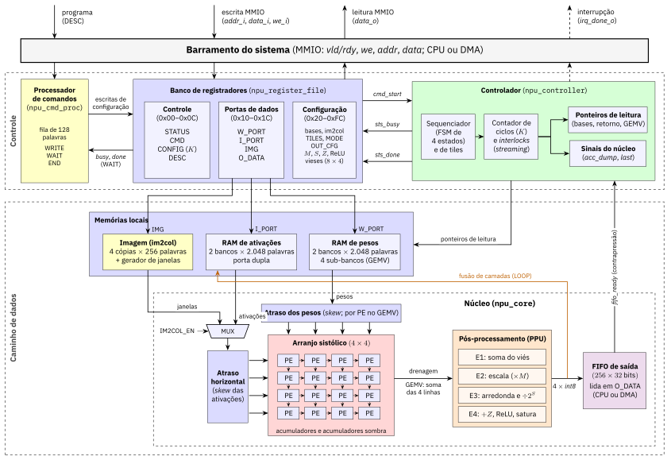
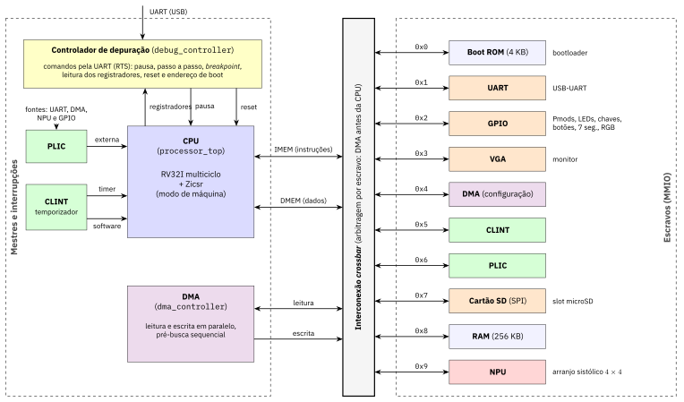

# Visão geral

A NPU (`npu_top.vhd`) é um coprocessador mapeado em memória. A CPU, ou um canal de DMA, configura-a escrevendo em registradores e envia os dados por portas dedicadas; a NPU calcula e entrega os resultados numa fila de saída, de onde são lidos pelo mesmo barramento.

<figure class="ax-figura" markdown>
  { width="780" }
  <figcaption>Arquitetura da NPU (<code>npu_top.vhd</code>). As ativações vêm da RAM de ativações ou, na convolução, das janelas montadas pelo <em>im2col</em> a partir da imagem, escolhidas por um multiplexador; os resultados passam pela PPU até a FIFO de saída ou, na fusão de camadas, voltam à RAM de ativações.</figcaption>
</figure>

A arquitetura se divide em um **plano de controle** e um **caminho de dados**.

## Plano de controle

- **Banco de registradores** (`npu_register_file`): decodifica os acessos MMIO. Reúne os registradores de controle (`STATUS`, `CMD`, `CONFIG`), as portas de dados (`W_PORT`, `I_PORT`, `IMG`, `O_DATA`, `DESC`) e a configuração das camadas (bases das memórias, geometria do *im2col*, número de *tiles*, modo, formato da saída, quantização e vieses). O mapa completo está na [API de programação](../software.md#api-de-programacao).
- **Controlador** (`npu_controller`): máquina de estados que, a partir de um comando `START`, gera os ponteiros de leitura das memórias locais e os sinais do núcleo, sequencia as passagens (*tiles*) e controla o esvaziamento dos acumuladores. Ver [Memórias e controle](memorias-controle.md).
- **Processador de comandos** (`npu_cmd_proc`): executa programas de configuração (descritores de camada) recebidos pela porta `DESC`, de modo que a CPU não precisa escrever registradores durante a inferência. Ver [Processador de comandos](memorias-controle.md#processador-de-comandos).

## Caminho de dados

- **Memórias locais:** RAM de pesos e RAM de ativações, com dois bancos de 2.048 palavras de 32 bits cada, e a memória de imagem do *im2col*. A RAM de pesos é dividida em 4 sub-bancos para o modo GEMV.
- **Núcleo** (`npu_core`): os registradores de alinhamento (*skew*) e o arranjo sistólico $4\times4$ de PEs com acumuladores de 32 bits. Ver [Núcleo de cálculo](nucleo.md).
- **Pós-processamento** (PPU): uma por coluna do arranjo, converte o acumulador de 32 bits em um INT8 (viés, escala, deslocamento com arredondamento, ReLU e saturação).
- **FIFO de saída:** 256 palavras de 32 bits, cada uma com os quatro resultados de uma linha. A fila exerce contrapressão sobre o controlador: se encher, o esvaziamento do arranjo pausa até a CPU ler.

## Integração ao SoC

No SoC RISC-V, a NPU é um escravo da interconexão *crossbar*, ao lado da RAM, da UART, do controlador de DMA e dos demais periféricos. A CPU (núcleo RV32I multiciclo) e o DMA são os mestres: a CPU programa a NPU e o DMA, e o DMA move pesos, imagens, programas de descritores e resultados entre a RAM e as portas da NPU, em paralelo com a execução da CPU.

<figure class="ax-figura" markdown>
  { width="700" }
  <figcaption>Diagrama de blocos do SoC (<code>soc_top.vhd</code>): mestres (CPU e DMA) e escravos mapeados em memória ligados por uma interconexão <em>crossbar</em>; a NPU ocupa a região <code>0x9</code> do mapa de endereços.</figcaption>
</figure>

## Interface com o sistema

A comunicação com o hospedeiro usa E/S mapeada em memória (MMIO): sinais de endereço, dado e escrita (`addr_i`, `data_i`, `we_i`) e leitura (`data_o`), com *handshake* de validade e prontidão (`vld`/`rdy`) que permite à NPU **segurar o barramento** quando um dado ainda não está disponível. Esse recurso é o que permite ler a saída ou enviar descritores sem consultar o registrador de estado. Ao fim de um cálculo, a NPU pode sinalizar a CPU pela interrupção `irq_done_o`.

## Mecanismos de movimentação de dados

O arranjo só calcula enquanto recebe dados. Num SoC em que CPU, memória e NPU dividem o barramento, enviar os pesos a cada inferência, montar as janelas da convolução na CPU ou configurar cada passagem com escritas MMIO deixaria o arranjo parado a maior parte do tempo. A NPU reúne os mecanismos abaixo, descritos em [Movimentação de dados](movimentacao-dados.md):

| Mecanismo | O que faz | Gargalo que elimina |
|---|---|---|
| Pesos e vieses residentes | Grava os parâmetros de todas as camadas uma única vez, em regiões separadas por camada | Retransferir os parâmetros a cada inferência |
| *im2col* em hardware | Recebe a imagem crua e gera as janelas da convolução dentro da NPU | CPU montando as janelas e enviando dados repetidos |
| Sequenciador de *tiles* | Executa todos os *tiles* de uma camada a partir de um único comando | CPU disparando e esperando cada *tile* |
| Modo GEMV | Na camada densa, divide a soma entre as quatro linhas do arranjo, com um peso por PE | Três das quatro linhas paradas |
| *Streaming* | Começa a calcular enquanto o DMA ainda entrega os dados | Carga e cálculo em série |
| Fusão de camadas | Grava a saída de uma camada na memória de entrada da NPU | Ida e volta pela memória principal |
| Descritores de camada | Executa um programa `WRITE`/`WAIT`/`END` e se configura sozinha | CPU configurando a NPU por MMIO |

Com eles, uma inferência completa se reduz, para a CPU, a duas transferências por DMA (o programa de descritores e a imagem) e à leitura do resultado.
