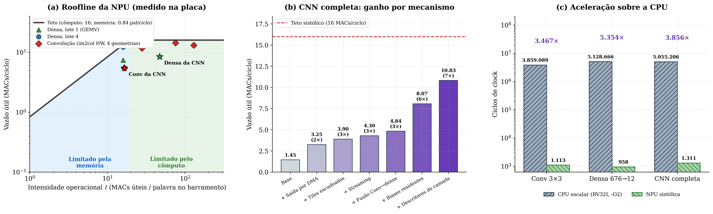
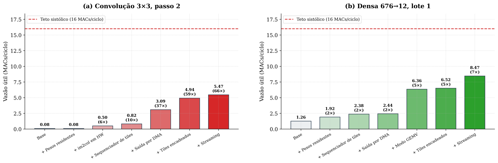
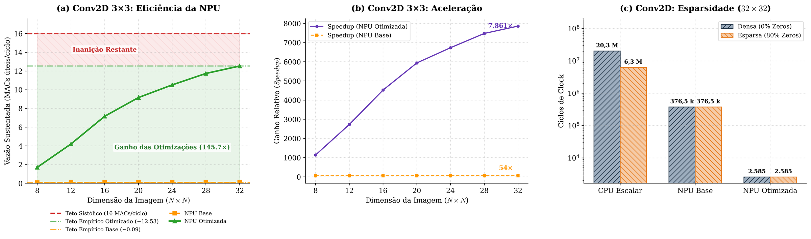
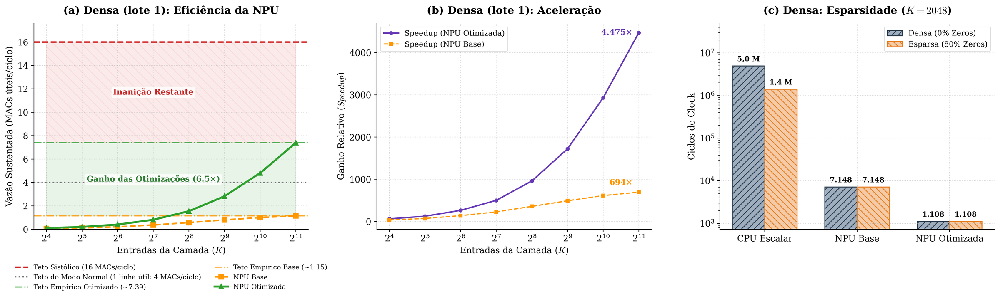

# Benchmark dos mecanismos

Esta página mede o efeito de cada [mecanismo de movimentação de dados e de controle](../arquitetura/movimentacao-dados.md) sobre as camadas da CNN do [estudo de caso](cnn-mnist.md) e sobre convoluções e camadas densas de tamanhos variados. As medições foram feitas na FPGA (Nexys A7-100T, 100 MHz), com a NPU integrada ao SoC RISC-V, pelo mesmo *benchmark* autovalidado descrito em [Desempenho da NPU](desempenho.md): cada resultado da NPU é recalculado pela CPU e comparado byte a byte, sem nenhuma divergência, e o tempo da NPU é idêntico em todas as repetições.

!!! note "Como ler uma ablação"
    Os mecanismos não são independentes: o *streaming* e a saída por DMA exigem o sequenciador, e os descritores exigem a fusão de camadas. Por isso não faz sentido medir cada um isoladamente. A **ablação cumulativa** liga os mecanismos um a um, sempre somando ao anterior, e a **ablação "deixa um de fora"** parte da configuração completa e remove um mecanismo (com os que dependem dele). O ganho de cada mecanismo depende de quais outros estão ligados.

## Visão geral

<figure class="ax-figura" markdown>
  { width="100%" }
  <figcaption>(a) Roofline da NPU medido na placa: vazão útil em função da intensidade operacional (MACs úteis por palavra que atravessa o barramento), com as camadas da CNN destacadas. (b) Ganho acumulado de cada mecanismo na CNN completa, com o teto sistólico. (c) Ciclos da CPU e da NPU por camada e na CNN completa.</figcaption>
</figure>

## Camadas da CNN, isoladas

Cada camada da CNN foi medida sozinha, ligando os mecanismos um a um. A configuração base usa os pesos enviados por DMA a cada execução, um `START` por *tile*, a CPU lendo a saída e, na convolução, o *im2col* feito pela CPU.

<figure class="ax-figura" markdown>
  { width="100%" }
  <figcaption>Vazão útil da convolução \(3\times3\) com passo 2 e da camada densa \(676\to12\) (lote 1) à medida que os mecanismos são ligados.</figcaption>
</figure>

| Convolução $28\times28$, $3\times3$, passo 2 | Ciclos | MACs úteis/ciclo |
|---|---:|---:|
| base | 73.005 | 0,08 |
| + pesos residentes | 72.803 | 0,08 |
| + *im2col* em hardware | 12.057 | 0,50 |
| + sequenciador de *tiles* | 7.375 | 0,82 |
| + saída por DMA | 1.968 | 3,09 |
| + *tiles* encadeados | 1.232 | 4,94 |
| + *streaming* | **1.113** | **5,47** |

| Densa $676\to12$, lote 1 | Ciclos | MACs úteis/ciclo |
|---|---:|---:|
| base | 6.440 | 1,26 |
| + pesos residentes | 4.222 | 1,92 |
| + sequenciador de *tiles* | 3.408 | 2,38 |
| + saída por DMA | 3.324 | 2,44 |
| + modo GEMV | 1.276 | 6,36 |
| + *tiles* encadeados | 1.244 | 6,52 |
| + *streaming* | **958** | **8,47** |

- **Na convolução, o *im2col* em hardware e a saída por DMA dominam.** Na base, quem desdobra a imagem em janelas é a CPU, e esse trabalho domina o tempo: o arranjo fica preso em 0,08 MACs por ciclo. Com o *im2col* na NPU, a camada fica 6× mais rápida; com a saída por DMA, a CPU deixa de consultar a FIFO a cada palavra. No total, a convolução fica 66× mais rápida.
- **Na camada densa, o modo GEMV é o maior salto.** Com uma única imagem, o modo normal usa só uma das quatro linhas do arranjo; o GEMV reparte as entradas entre as quatro e leva a camada de 2,44 para 6,36 MACs por ciclo. O *streaming* vem em seguida, porque a carga das entradas é comparável ao cálculo.
- **Os pesos residentes quase não mudam a convolução** (os 9 pesos são poucos), mas economizam um terço do tempo da densa, que tem 2.028 palavras de pesos.

## CNN completa

Na rede inteira, a convolução e a densa encadeadas, entram também a fusão de camadas, os vieses residentes e os descritores.

| Configuração (ablação cumulativa) | Ciclos | MACs úteis/ciclo | *Speedup* sobre a CPU |
|---|---:|---:|---:|
| base | 9.810 | 1,45 | 515× |
| + saída por DMA | 4.368 | 3,25 | 1.157× |
| + *tiles* encadeados | 3.640 | 3,90 | 1.389× |
| + *streaming* | 3.301 | 4,30 | 1.531× |
| + fusão Conv → densa | 2.931 | 4,84 | 1.725× |
| + vieses residentes | 1.759 | 8,07 | 2.874× |
| + descritores de camada | **1.311** | **10,83** | **3.856×** |

- **Os mecanismos de controle valem juntos cerca de 2,2×** (de 2.931 para 1.311 ciclos). Eles se sobrepõem em parte: com descritores, gravar os vieses dentro do programa custa pouco, porque quem escreve é a NPU, e não a CPU. O ganho grande vem de tirar a CPU do caminho de controle.
- **Na ablação "deixa um de fora"**, o encadeamento de *tiles* e a fusão são os mecanismos de dados que mais pesam na rede completa: removê-los aumenta o tempo em cerca de 60%, contra cerca de 15% para o *streaming*.
- **Na placa, o `cnn_server` mede 1.506 ciclos para a mesma rede.** A diferença para o *benchmark* vem do laço de leitura dos resultados e da espera pelo fim do programa no *firmware*.

## Por tipo de operação

Por fim, a NPU **base** (sem os mecanismos) e a **otimizada** (com todos eles) foram comparadas em convoluções $3\times3$ de passo 1 com imagens de $8\times8$ a $32\times32$ (o limite do *im2col*) e em camadas densas de lote 1 com 4 neurônios e $K$ de 16 a 2.048, com a CPU como referência em todos os pontos.

<figure class="ax-figura" markdown>
  { width="100%" }
  <figcaption>Convolução \(3\times3\): (a) vazão da NPU base e otimizada; (b) aceleração sobre a CPU em função do tamanho da imagem; (c) efeito de 80% de ativações nulas em \(32\times32\).</figcaption>
</figure>

<figure class="ax-figura" markdown>
  { width="100%" }
  <figcaption>Camada densa de lote 1: (a) vazão da NPU base e otimizada, com o teto de 4 MACs por ciclo do modo normal; (b) aceleração sobre a CPU em função de \(K\); (c) efeito de 80% de ativações nulas em \(K=2048\).</figcaption>
</figure>

| Operação | Tamanho | Base (ciclos) | Base (MACs/ciclo) | Otim. (ciclos) | Otim. (MACs/ciclo) | *Speedup* otim. |
|---|---:|---:|---:|---:|---:|---:|
| Conv2D $3\times3$ | $8\times8$ | 16.238 | 0,08 | 761 | 1,70 | 1.140× |
| Conv2D $3\times3$ | $16\times16$ | 83.006 | 0,09 | 985 | 7,16 | 4.526× |
| Conv2D $3\times3$ | $32\times32$ | 376.510 | 0,09 | **2.585** | **12,53** | **7.861×** |
| Densa, lote 1 | $K=256$ | 1.779 | 0,58 | 660 | 1,55 | 960× |
| Densa, lote 1 | $K=2.048$ | 7.148 | 1,15 | **1.108** | **7,39** | **4.475×** |

- **Convolução: ganho de 146× entre a base e a otimizada.** É o maior de todos, porque na base o *im2col* é feito pela CPU e domina o tempo; a NPU base fica presa em cerca de 0,09 MACs por ciclo, qualquer que seja o tamanho, e a aceleração da base sobre a CPU é constante (cerca de 54×).
- **Densa: ganho de 6,5×.** A base esbarra no teto de 4 MACs por ciclo do modo normal (uma linha útil) e, antes dele, no DMA dos pesos a cada execução; o GEMV com pesos residentes passa desse teto.
- **Esparsidade:** com 80% de ativações nulas, a CPU fica 3,2× mais rápida na convolução e 3,5× na densa, porque a multiplicação por software termina mais cedo quando o fator é zero. A NPU mantém exatamente o mesmo tempo: os PEs multiplicam os zeros normalmente.
