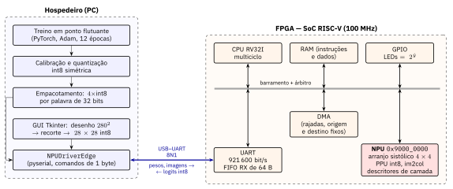
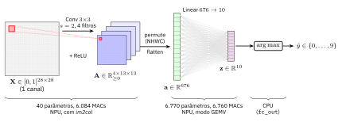
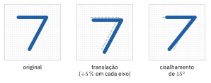
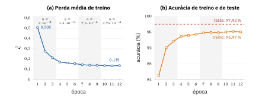
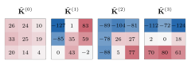
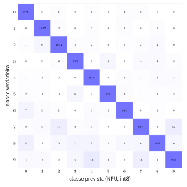

# Estudo de caso: CNN para o MNIST

Para avaliar a NPU em uma aplicação completa, uma rede convolucional foi treinada para classificar os dígitos manuscritos do MNIST e executada no SoC RISC-V na FPGA. Esta página reúne o modelo, a quantização, o mapeamento das camadas no arranjo e as medições na placa.

## Arquitetura da solução

No hospedeiro, um cliente em Python treina a rede, converte os parâmetros para inteiros e os envia uma única vez ao SoC pela UART (8.216 bytes). O SoC, a 100 MHz, reúne o núcleo RISC-V, memória, UART a 921.600 bit/s, um controlador de DMA e a NPU. A cada inferência, a interface reduz o dígito desenhado a uma imagem $28\times28$ de inteiros e a envia ao SoC (784 bytes). O *firmware* repassa a imagem crua à NPU, que monta as janelas $3\times3$ e calcula a convolução e a camada densa, e a CPU devolve os 10 *logits* e acende o LED do dígito previsto.

<figure class="ax-figura" markdown>
  { width="780" }
  <figcaption>Arquitetura da solução: o hospedeiro realiza treino, quantização e interface com o usuário; o SoC RISC-V executa a inferência INT8 na NPU, orquestrada pelo <em>firmware</em> <code>cnn_server.c</code>.</figcaption>
</figure>

## Modelo

O modelo aplica quatro filtros $3\times3$ com passo 2 e a ReLU, gerando quatro mapas de $13\times13$, e em seguida uma camada densa que leva as 676 ativações aos 10 *logits*. A convolução tem menos de 1% dos parâmetros, mas quase metade do custo, justamente por reaproveitar 36 pesos em 169 posições.

```python
class Conv2D_Model(nn.Module):
    def __init__(self):
        super().__init__()
        self.conv = nn.Conv2d(1, 4, kernel_size=3, stride=2, padding=0)
        self.relu = nn.ReLU()
        self.flatten = nn.Flatten()
        self.fc = nn.Linear(13 * 13 * 4, 10)

    def forward(self, x):
        x = self.relu(self.conv(x))
        x = x.permute(0, 2, 3, 1)   # NHWC: ordem de saída da NPU
        return self.fc(self.flatten(x))
```

Um detalhe do código decorre diretamente do hardware: a linha `permute`. Por padrão, o PyTorch guarda os mapas um após o outro, primeiro todo o mapa do filtro 0, depois o do filtro 1, e assim por diante. A NPU, porém, devolve os resultados pixel a pixel, com os quatro filtros de cada pixel juntos. O `permute` coloca os dados nessa mesma ordem (**NHWC**) antes do achatamento, de modo que a camada densa é treinada já na ordem em que o hardware entrega as ativações, e o *firmware* não precisa reordená-las.

<figure class="ax-figura" markdown>
  { width="760" }
  <figcaption>Rede convolucional utilizada. A janela <span class="arithmatex">\(3\times3\)</span> destacada gera um elemento de cada um dos quatro mapas; o achatamento em ordem NHWC produz o vetor de 676 elementos da camada densa.</figcaption>
</figure>

| Camada | Saída | Parâmetros | MACs |
|---|---|---:|---:|
| Conv $3\times3$, $s=2$, $1\to4$ | $4\times13\times13$ | $36+4=40$ | $169\cdot4\cdot9=6.084$ |
| ReLU, `permute`, `flatten` | 676 | — | — |
| Linear $676\to10$ | 10 | $6.760+10=6.770$ | 6.760 |
| **Total** | | **6.810** | **12.844** |

## Treinamento

A rede é treinada com as 60.000 imagens de treino do MNIST, com pixels normalizados para $[0,1]$, em 12 épocas com lotes de 32 imagens. O Adam parte de uma taxa de aprendizado de $3\times10^{-3}$, reduzida à metade a cada três épocas. Para que a rede aprenda a reconhecer dígitos que nunca viu, usa-se **aumento de dados**: a cada apresentação, a imagem é levemente deslocada (até $\pm1{,}4$ pixel) e inclinada (até $15^\circ$), como acontece quando alguém desenha na interface.

<figure class="ax-figura" markdown>
  { width="460" }
  <figcaption>Aumento de dados, com as transformações no valor máximo usado no treino. A linha tracejada cinza é o dígito original.</figcaption>
</figure>

A perda média de treino cai de 0,508 na primeira época para 0,135 na última, com quedas visíveis a cada redução da taxa de aprendizado. A acurácia final de treino (95,97%) fica abaixo da de teste, o que se explica pelo aumento de dados: as imagens de treino são deformadas, as de teste não.

<figure class="ax-figura" markdown>
  { width="700" }
  <figcaption>Evolução do treino por época. (a) Perda média de entropia cruzada. (b) Acurácia nas imagens de treino e acurácia de teste da rede final em ponto flutuante (tracejada). As faixas marcam os patamares da taxa de aprendizado.</figcaption>
</figure>

## Quantização e acurácia

A NPU usa $M=1$ e $S=8$ nas duas camadas, ou seja, divide sempre por 256. Para cada camada, o cliente escolhe a maior escala de pesos que respeite duas condições: o maior peso, em módulo, vira no máximo 127, e o maior resultado observado em 32 imagens de calibração vira no máximo 120 depois da divisão (ver [Quantização para INT8](../fundamentos.md#quantizacao-para-inteiros)).

As escalas se encadeiam ao longo da rede. A imagem chega multiplicada por cerca de 127, pois cada pixel $p$, de 0 a 255, é enviado como $\lfloor p/2\rfloor$. Na convolução, os filtros trazem o fator $s_1$ e a PPU divide por 256, de modo que cada ativação inteira equivale à ativação real multiplicada por um fator conhecido; a camada densa repete o processo com $s_2$. No fim, cada *logit* inteiro é aproximadamente o *logit* real multiplicado por uma mesma constante positiva, $\alpha$, e a rede quantizada escolhe o mesmo dígito que a original; os arredondamentos só podem mudar a decisão quando os dois maiores *logits* estão quase empatados.

As duas camadas se comportam de forma diferente. Na convolução, a escala foi limitada pela faixa dos pesos, e os filtros inteiros ocupam a faixa $[-127, 83]$, aproveitando bem os 256 níveis; nenhuma ativação de teste saturou. Na camada densa, a escala foi limitada pela margem de ativação: os *logits* reais chegam a 32,5, e, para que coubessem em 8 bits depois da divisão por 256, a escala dos pesos teve de ser reduzida. Os pesos inteiros ficaram em $[-62, 43]$, menos da metade dos níveis disponíveis.

<figure class="ax-figura" markdown>
  { width="460" }
  <figcaption>Filtros convolucionais quantizados enviados à NPU.</figcaption>
</figure>

| Configuração | Acurácia (10.000 imagens de teste) |
|---|---:|
| Rede original, em ponto flutuante | 97,92% |
| Rede original, com a entrada já em 7 bits | 97,91% |
| Rede INT8, emulação bit a bit da NPU | 97,79% |

A quantização quase não afeta a acurácia: quantizar a rede inteira custa **0,13 ponto percentual**. Mais do que isso, as duas redes decidem igual imagem a imagem: concordam em 99,69% das imagens, divergindo em apenas 31. Essas divergências ocorrem quando os dois maiores *logits* estão quase empatados: um passo do *logit* inteiro vale cerca de 0,27 unidade do *logit* real, e duas classes mais próximas que isso podem receber o mesmo valor inteiro; é o caso de 18 das 31 divergências, que o *firmware* desempata escolhendo o menor índice. A matriz de confusão mostra que os erros restantes se concentram em pares de dígitos de formas parecidas.

<figure class="ax-figura" markdown>
  { width="380" }
  <figcaption>Matriz de confusão da inferência INT8 emulada no conjunto de teste. A escala de cores satura em 60 para evidenciar os erros.</figcaption>
</figure>

!!! tip "Requantização por camada"
    Usar o mesmo divisor nas duas camadas simplifica o *firmware*, mas obriga a reduzir a escala dos pesos da camada densa. Como a PPU aceita $M$ e $S$ programáveis, calcular um par $(M,S)$ para cada camada permitiria usar a faixa inteira do INT8 sem alterar o hardware.

## Execução no SoC

Cada camada é alocada no arranjo como descrito em [Mapeamento de camadas](../mapeamento.md#da-ilustracao-a-rede-real): a convolução em 43 passagens de $K=9$, com 98% das MACs úteis, e a camada densa em três passagens GEMV de 169 passos, com 83%. O que se repete entre passagens define como o *firmware* alimenta a NPU, e quase nada precisa trafegar a cada imagem:

1. **Carga do modelo:** os pesos das duas camadas e os vieses ficam residentes na NPU, e o *firmware* monta, uma única vez, o [programa de descritores](../arquitetura/memorias-controle.md#exemplo-a-cnn-do-mnist) que configura e dispara as duas camadas.
2. **A cada imagem:** a CPU recebe os 784 pixels pela UART e dispara duas transferências de DMA: o programa, para o processador de comandos, e a imagem crua, para a unidade de *im2col*.
3. **Convolução:** um único disparo executa as 43 passagens, relendo os pesos a cada uma e encadeando-as sem esvaziar o arranjo; o cálculo começa enquanto a imagem ainda chega. A saída, já na ordem NHWC, é gravada direto na memória de entradas da NPU.
4. **Camada densa:** a lógica se inverte: as 169 palavras de entrada são relidas a cada bloco, e o ponteiro dos pesos avança para o bloco seguinte, cada um com o seu vetor de viés.
5. **Resultado:** a CPU lê as três palavras com os 10 *logits* na porta de saída, sem consultar o estado da NPU, e calcula o $\arg\max$.

A NPU executa a rede inteira em **1.506 ciclos** (15 µs a 100 MHz), ou 8,5 MACs úteis por ciclo. Executada apenas na CPU, a mesma rede levaria cerca de 80 ms: uma diferença de mais de três ordens de grandeza.

## Medições na placa

Na placa, 100 imagens de teste foram executadas com os mesmos pesos da emulação. Os *logits* devolvidos pelo SoC **coincidiram byte a byte** com os da emulação nas 100 imagens, e 99 foram classificadas corretamente: a emulação reproduz fielmente o hardware.

Uma inferência completa, do envio da imagem à chegada dos *logits*, leva **9,2 ms**. Com a configuração padrão do conversor USB-serial da placa, a medida sobe para 15,9 ms, porque o conversor retém respostas curtas por até 16 ms. Do total:

| Etapa | Tempo |
|---|---:|
| Transmissão serial da imagem e dos *logits* | 8,6 ms |
| CPU: escolher o dígito e enviar os *logits* (quase todo esperando a UART) | cerca de 0,1 ms |
| Cálculo da rede na NPU, já incluídas as transferências por DMA | 15 µs |
| Trânsito pela USB e tempo do hospedeiro | cerca de 0,5 ms |

O sistema processa cerca de 109 imagens por segundo. **O acelerador não é o gargalo**: num SoC em que tudo passa por um único barramento, o que limitava a NPU era a movimentação de dados e o controle, e não o arranjo. Resolvidos esses custos, a inferência completa passa a ser dominada pela comunicação serial, e reduzir a latência agora depende de um enlace mais rápido com o hospedeiro, e não de aumentar o arranjo.

!!! note "Acurácia na placa e no artigo do TCC"
    O artigo do TCC relata 97,2% de acurácia em 1.000 imagens de teste, medidos na própria placa. Os 97,79% acima são da emulação bit a bit nas 10.000 imagens de teste, cujos *logits* a placa reproduz byte a byte.
