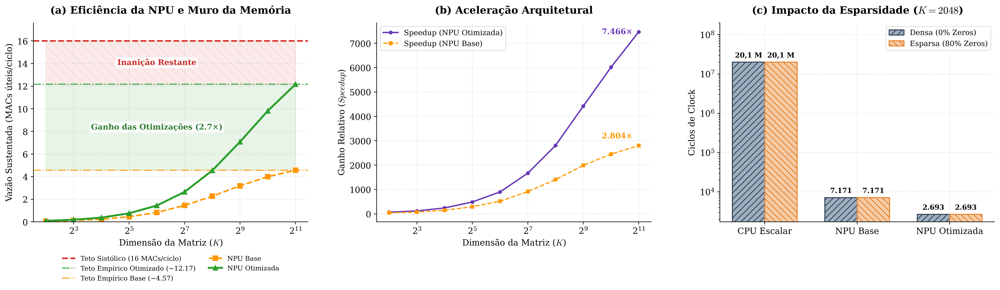

# Desempenho da NPU

Os resultados desta página foram medidos na FPGA (Nexys A7-100T, 100 MHz), com a NPU integrada ao [SoC RISC-V](https://github.com/RISC-V-Azedinha/RISC-V). Para que as métricas não dependam da tecnologia nem da frequência, elas são expressas em **ciclos de clock**, tendo como referência o núcleo RV32I executando o mesmo algoritmo.

O *benchmark* é um *firmware* *bare-metal* parametrizado: cada experimento define uma camada e os mecanismos da NPU habilitados, sobre dados pseudoaleatórios gerados na própria placa, com os ciclos medidos pelo contador do CLINT. **Cada resultado da NPU é recalculado pela CPU e comparado byte a byte**: não houve divergência, e o tempo da NPU foi idêntico em todas as repetições. A métrica principal é a vazão útil, em MACs úteis por ciclo. Comparam-se duas configurações:

- **base:** sem os [mecanismos de movimentação de dados](../arquitetura/movimentacao-dados.md), com os pesos enviados por DMA a cada execução, um `START` por *tile* e a CPU lendo a saída;
- **otimizada:** com todos eles (pesos residentes, sequenciador, saída por DMA, *tiles* encadeados e *streaming*), o que pressupõe o reaproveitamento dos pesos entre execuções, típico da inferência.

## Metodologia

### A CPU de referência

#### Motivação

A avaliação de desempenho de aceleradores dedicados, como a NPU proposta neste trabalho depende da definição de uma *baseline* de CPU adequada. Comparações diretas de tempo de execução ou throughput absoluto tendem a ser fortemente influenciadas por fatores externos à arquitetura - como frequência de clock, tecnologia de fabricação, compiladores otimizados e microarquiteturas proprietárias - o que dificulta a análise do ganho arquitetura proporcionado pelo acelerador.

Dessa forma, este trabalho adota como princípio metodológico a comparação em número de ciclos e em nível arquitetural, abstraindo deliberadamente a frequência de operação. O objetivo não é reproduzir fielmente o comportamento de um microcontrolador comercial específico, mas sim estabelecer limites plausíveis para uma CPU de classe de microprocessadores embarcados (*embedded*), contra a qual o ganho da NPU possa ser avaliado de forma justa e reprodutível.

#### RV32I Multiciclo

A CPU utilizada como baseline neste SoC (System-on-a-Chip) é uma implementação RV32I-like estritamente multiciclo, sem pipeline, sem execução fora de ordem e sem extensões opcionais (M, F, V etc.). Cada instrução é decomposta em estágios funcionais sequenciais, com latências determinadas por restrições reais de FPGA, em especial:

- Latência de memória síncrona (IF e MEM com múltiplos ciclos);
- Caminhos críticos de lógica combinacional;
- Reuso de unidades funcionais para minimizar área.

Uma configuração típica de latências por instrução é apresentada abaixo:

| Estágio | Latência (ciclos) | Observações |
| --- | --- | --- |
| **IF** | 2 | Memória síncrona |
| **ID** | 1 | Decodificação e leitura de registradores |
| **EX** | 1-2 | Branches com latência adicional |
| **MEM** | 1-2 | Dependente da operação |
| **WB** | 1 | Escrita em registradores |

!!! quote "CPI Médio"
    Assim, o custo médio por instrução (CPI - *Cycles per Instruction*) situa-se tipicamente entre 6 e 8 ciclos, dependendo do código sendo executado pelo processador.

Essa CPU representa um ponto de referência conservador, porém realista, para sistemas embedded minimalistas, educacionais ou orientados a baixo consumo.

#### Comparação com MCU Comercial

Microcontroladores modernos baseados em RISC-V - como o ESP32-C3 - ou ARM (série M) incorporam uma série de otimizações microarquiteturais que dificultam uma comparação direta:

- Pipeline profundo (tipicamente 3 a 5 estágios);
- Execução especulativa e prefetch;
- Unidades aritméticas dedicadas e paralelas;
- Barramentos e hierarquias de memória otimizadas.

Embora essas técnicas reduzam o número médio de ciclos por instrução, elas existem principalmente para viabilizar frequências mais altas, e não necessariamente para reduzir o trabalho arquitetural intrínseco da computação.

Comparar diretamente tempos absolutos ou benchmarks compilados para tais CPUs introduziria variáveis difíceis de isolar, como qualidade do compilador, agressividade de otimizações e detalhes proprietários não documentados.

#### Classe de Arquiteturas Consideradas

O *baseline* proposto representa a classe de processadores com as seguintes características:

- ISA: RV32I com extensão de multiplicação (RV32IM);
- Execução escalar (1 operação aritmética por instrução);
- Sem unidades vetoriais ou SIMD;
- Sem aceleração dedicada para MACs.

Essa classe inclui tanto processadores multi-cycles simples quanto microcontroladores modernos com pipeline e multiplicador em hardware. Diferenças microarquiteturais afetam latência e frequência, mas não alteram os limites fundamentais impostos pela ISA.

Considere a computação de um único MAC escalar:

$$ 
\text{acc} \ \leftarrow \ \text{acc}+(a\times b)
$$ 

Em **RV32IM**, mesmo assumindo otimizações ideais, essa operação exige no mínimo:

1. Um `load` para o operando `a`;
2. Um `load`para o operando `b`;
3. Uma instrução de multiplicação (`mul`);
4. Uma instrução de soma (`add`).

Portanto, cada MAC requer pelo menos **4 instruções**.

Assumindo-se um cenário otimista:

- CPI = 1;
- Pipeline ideal;
- Cache perfeito;
- Sem stalls.

Obtém-se o limite inferior teórico: $\text{Ciclos}_{\text{CPU}}\ge 4\times N_{\text{MAC}}$. Esse resultado é independente de frequência, tecnologia ou microarquitetura específica.

Com base nas observações anteriores, define-se o modelo matemático do baseline de CPU como:

$$
T_{\text{CPU}}^{\text{min}}=4\cdot N_{\text{MAC}}
$$

Onde:

- $N_{\text{MAC}}$ = número total de operações MAC do workload;
- $T_{\text{CPU}}^{\text{min}}$ = tempo mínimo em ciclos.

Esse modelo não representa um processador real, mas sim um limite inferior teórico para qualquer CPU RV32 escalar compatível com a ISA.

#### Justificativa do Uso de um Core RV32I Multiciclo

A implementação de um core RV32I multi-cycle no SoC proposto não busca competir em desempenho absoluto, mas sim:

- Evidenciar de forma clara os gargalos arquiteturais da execução escalar;
- Facilitar análise ciclo-a-ciclo e verificação funcional;
- Servir como plataforma educacional e experimental.

Importante ressaltar que, **mesmo substituindo esse core por uma CPU pipelined ideal**, o limite inferior definido permanece válido.

### Limites do *speedup*

A aceleração obtida por meio de unidades especializadas, como NPUs (Neural Processing Units), é frequentemente reportada como um fator de *speedup* em relação à execução puramente em software. No entanto, tais valores isolados podem ser enganosos se não forem contextualizados por limites teóricos e arquiteturais bem definidos.

Este capítulo busca estabelecer:

- A natureza do *workload* (operações matriciais e convolucionais);
- Restrições impostas por memória, DMA e interconexão;
- Grau de paralelismo efetivamente explorável.

Dessa forma, busca-se responder à pergunta central:

!!! question "Speedup"
    O speedup observado representa um limite estrutural da arquitetura ou um artefato da CPU baseline escolhida?

#### Definição Formal de Speedup

O speedup é definido de forma clássica como:

$$
S=\cfrac{T_{\text{CPU}}}{T_{\text{CPU+NPU}}}
$$

onde:

- $T_{\text{CPU}}$ = tempo de execução do workload completo utilizando apenas a CPU;
- $T_{\text{CPU+NPU}}$ = tempo de execução considerando offload da computação para a NPU.

Como a análise é feita em termos arquiteturais, o tempo é expresso em **número de ciclos de clock**, não em segundos, eliminando a dependência de frequência de clock.

#### Overhead de Offload

O primeiro limite fundamental é que nenhuma NPU pode ser mais rápida do que o custo de invocá-la. O tempo total com aceleração pode ser decomposto como:

$$
T_{\text{CPU+NPU}}=T_{\text{setup}}+T_{\text{DMA}}+T_{\text{NPU}}+T_{\text{sync}}
$$

Onde:

- $T_{\text{setup}}$ = escrita de CSRs e comandos;
- $T_{\text{DMA}}$ = transferência de dados;
- $T_{\text{NPU}}$ = computação efetiva;
- $T_{\text{sync}}$ = polling ou interrupção.

Isso implica que workloads pequenos ou com baixa intensidade aritmética possuem **speedup próximo de 1 ou até < 1**, independentemente da NPU.

Esse limite explica porque: vetores curtos; poucas iterações; ou kernels pouco densos, não se beneficiam significativamente da aceleração. 

O limite superior teórico ocorre quando:

1. Todo o tempo de computação da CPU é substituído por computação paralela na NPU;
2. Overheads de comunicação são desprezíveis;
3. A NPU opera com utilização plena.

Nesse cenário hipotético:

$$
S_{\text{max}}\approx\cfrac{C_{\text{CPU}}}{C_{\text{NPU}}}
$$

onde:

- $C_{\text{CPU}}$ = ciclos necessários para executar o kernel em software;
- $C_{\text{NPU}}$ = ciclos necessários para executar o mesmo kernel na NPU.

Para workloads típicos de inferência (MACs, convoluções, GEMMs):

$$
C_{\text{CPU}} \propto N_{\text{ops}}
$$

$$
C_{\text{NPU}} \propto \ \cfrac{N_{\text{ops}}}{P}
$$

onde $P$ é o grau de paralelismo da NPU.

Assim, o *speedup* máximo teórico é aproximadamente: $S_{\text{max}}\approx P$. Esse resultado é consistente com literatura clássica de arquiteturas SIMD, arranjos sistólicos e aceleradores.

#### Lei de Amdahl Aplicada à NPU

Na prática, apenas uma fração do código é acelerável. Aplicando a Lei de Amdahl:

$$
S=\cfrac{1}{(1-f)+\cfrac{f}{s_{\text{acc}}}}
$$

onde:

- $f$ = fração do tempo total originalmente gasta em computação acelerável;
- $S_{\text{acc}}$ = speedup do trecho acelerado.

Mesmo com $S_{\text{acc}} \rightarrow \infty$, o speedup total é limitado por $1\ / \ (1-f)$. No contexto deste SoC:

- loops de MACs e ReLU $\rightarrow$  alto $f$;
- controle, configuração, I/O $\rightarrow$ baixo $f$.

Isso explica porque o speedup observado **satura** mesmo quando a NPU é escalada.

#### Limite Prático

Na implementação real de um SoC, o teto de speedup é reduzido por:

1. **Largura de banda da memória**: a NPU só é tão rápida quanto o fornecimento de dados;
2. **Arbitragem do barramento**: mesmo com comportamento determinístico, há ciclos não produtivos;
3. **Granularidade do DMA**: transferências em blocos impõem latência mínima.

Esses fatores impõem um teto prático:

$$
S_{\text{prático}}<S_{\text{max}}
$$

A observação de ciclos praticamente constantes entre execuções reforça que:

- O sistema opera em regime determinístico e previsível;
- O teto observado é estrutural, não estatístico.

O speedup máximo medido experimentalmente deve ser interpretado como: o teto de aceleração da arquitetura atual para aquele padrão de workload e hierarquia de memória. Não se trata de um limite universal - mas, sim, um ponto de equilíbrio entre paralelismo computacional, capacidade de alimentação de dados e custo de orquestração pela CPU.

## Eficiência e o muro da memória

O experimento usa uma multiplicação de matrizes que ocupa o arranjo inteiro (quatro vetores de entrada por quatro saídas), variando a dimensão $K$ até 2.048, o limite da memória local da NPU.

| $K$ | CPU (ciclos) | NPU base | NPU otim. | MACs/ciclo base | MACs/ciclo otim. | *Speedup* otim. |
|---:|---:|---:|---:|---:|---:|---:|
| 16 | 154.376 | 1.093 | 665 | 0,23 | 0,38 | 232× |
| 64 | 630.573 | 1.208 | 697 | 0,85 | 1,47 | 905× |
| 256 | 2.534.236 | 1.779 | 889 | 2,30 | 4,61 | 2.851× |
| 1.024 | 10.085.548 | 4.080 | 1.657 | 4,02 | 9,89 | 6.087× |
| 2.048 | 20.047.014 | 7.148 | 2.681 | 4,58 | 12,22 | 7.477× |

<figure class="ax-figura" markdown>
  { width="100%" }
  <figcaption>(a) Vazão da NPU nas duas configurações e o muro da memória. (b) Aceleração sobre a CPU em função de \(K\). (c) Impacto de 80% de ativações nulas em \(K=2048\).</figcaption>
</figure>

**(a) O muro da memória.** Na configuração base, a cada passo de $K$ a NPU aguarda uma palavra de pesos e uma de ativações antes de calcular (cerca de três ciclos por passo), o que limita a vazão a $16/3\approx5{,}3$ MACs por ciclo: ela estabiliza em 4,6, com o arranjo ocioso cerca de 71% do tempo. Na configuração otimizada, os pesos residentes eliminam o tráfego de parâmetros e o *streaming* sobrepõe a chegada das ativações ao cálculo, de modo que cada passo custa cerca de um ciclo: a vazão atinge **12,22 MACs por ciclo** em $K=2048$ (76% de utilização) e tende ao teto sistólico.

Resta um custo fixo de cerca de 670 ciclos por execução, devido ao *overhead* de configuração da NPU, de movimentação de dados e de esvaziamento do arranjo. Em matrizes pequenas, esse custo domina: até $K=32$, a configuração otimizada leva os mesmos 665 ciclos.

**(b) Aceleração.** O *speedup* cresce com $K$ à medida que o custo fixo se dilui, chega a **7.477×** em $K=2048$ e tende a um platô determinado pela razão entre os custos por operação da CPU e da NPU. As curvas ainda sobem no maior $K$ medido, porque $K$ está limitado pela capacidade da memória local, e não pela saturação.

**(c) Esparsidade.** Na CPU, sem multiplicador em hardware, cada produto é uma rotina de software que soma e desloca bit a bit e termina quando o fator se anula: com 80% de ativações nulas, a execução cai de 20,0 para 5,6 milhões de ciclos. Na NPU, as multiplicações por zero são calculadas integralmente pelos PEs, e a contagem de ciclos não muda: **o tempo é determinístico**, mas a esparsidade não é aproveitada.

## Rede completa

Na [CNN do estudo de caso](cnn-mnist.md), o custo fixo é pago uma única vez por imagem, e não a cada passagem. Executada na placa, a NPU calcula a rede inteira, da chegada do programa de descritores à gravação dos *logits*, em **1.506 ciclos** (15 µs a 100 MHz), ou 8,5 MACs úteis por ciclo. Sem os mecanismos, com a CPU montando as janelas e controlando cada passagem, a mesma rede levava 226.417 ciclos.

| Configuração da CNN | Ciclos por imagem | MACs úteis/ciclo |
|---|---:|---:|
| CPU fazendo o *im2col* e o controle, sem os mecanismos | 226.417 | 0,06 |
| Todos os mecanismos | **1.506** | **8,5** |

Outros números da integração no SoC:

- Em convoluções com *kernels* maiores, a vazão chega a 14,4 MACs por ciclo.
- A transferência de dados por DMA é 14,7× mais rápida que por escritas da CPU (PIO).
- O SoC completo ocupa 107,5 dos 135 blocos BRAM36 da Artix-7 e cerca de 11 mil LUTs, com o *timing* fechado a 100 MHz.

!!! note "O gargalo passa a ser o sistema"
    Com o cálculo em 15 µs, a latência percebida de uma inferência pela UART (cerca de 9 ms) é dominada pela comunicação serial: o cálculo é menos de 0,2% do tempo total. Pela Lei de Amdahl, nem uma NPU infinitamente rápida reduziria essa latência em mais de 0,2%; o próximo ganho depende de um enlace mais rápido com o hospedeiro. Ver [Estudo de caso](cnn-mnist.md#medicoes-na-placa).

## Referências

- AMDAHL, Gene M. Validity of the single processor approach to achieving large scale computing capabilities. In: Proceedings of the April 18-20, 1967, spring joint computer conference. 1967. p. 483-485.
- Espressif Documentation. Disponível em: <https://documentation.espressif.com/esp32-c3_datasheet_en.pdf>.
- HENNESSY, John L.; PATTERSON, David A. Computer architecture: a quantitative approach. Elsevier, 2011.
- PATTERSON, David A.; HENNESSY, John L. Computer organization and Design. The Hardware/Soft, 2022.
- HARRIS, Sarah; HARRIS, David. Digital Design and Computer Architecture, RISC-V Edition. Morgan Kaufmann, 2021.