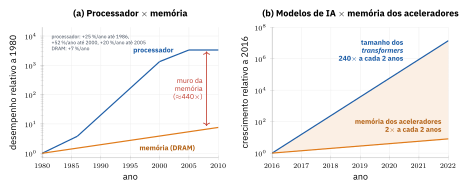
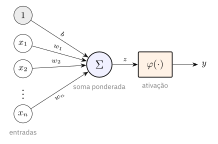
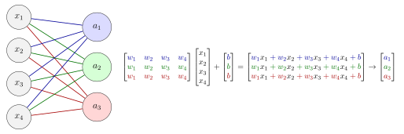
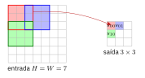
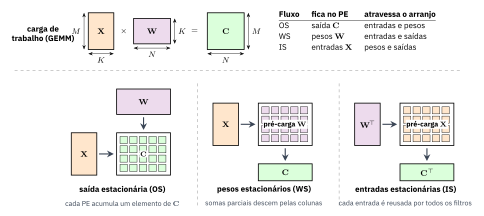
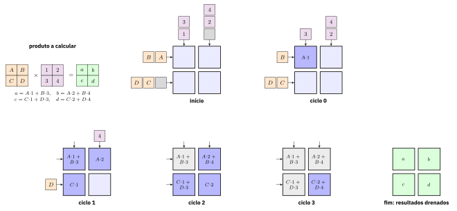

# Fundamentos

Este capítulo reúne a base teórica do restante da documentação: por que aceleradores dedicados se tornaram necessários, o que uma rede neural calcula, como esse cálculo é convertido para inteiros de 8 bits e como um arranjo sistólico o executa.

## Por que aceleradores dedicados

Durante décadas, o desempenho dos processadores cresceu pela elevação da frequência e pela exploração do paralelismo em nível de instrução. Com o fim do escalonamento de Dennard, por volta de 2005, a densidade de potência deixou de permitir esse ritmo: o ganho anual caiu de cerca de 52% na era RISC para poucos pontos percentuais. A inovação migrou, então, para o co-projeto de hardware e software, com **arquiteturas específicas de domínio** (DSAs), como as NPUs, que exploram o paralelismo de dados, gerenciam explicitamente a memória e operam com precisão reduzida.

<figure class="ax-figura" markdown>
  { width="640" }
  <figcaption>Desempenho dos processadores relativo ao VAX-11/780: o crescimento desacelera após o fim do escalonamento de Dennard (adaptado de Hennessy e Patterson).</figcaption>
</figure>

### O muro da memória

O principal desafio no projeto de uma NPU não está no custo das operações aritméticas, mas no tempo e na energia gastos para **mover os dados** entre a memória e as unidades de cálculo. O desempenho dos processadores cresceu muito mais depressa que o da memória, e a distância entre os dois, o ***memory wall***, só aumentou. Nas redes neurais modernas, o fenômeno se repete em outra escala: o tamanho dos modelos cresce duas ordens de grandeza mais depressa que a memória dos aceleradores.

<figure class="ax-figura" markdown>
  { width="100%" }
  <figcaption>(a) Desempenho do processador e da memória DRAM, com as taxas de crescimento de Hennessy e Patterson. (b) Tendência do tamanho dos <em>transformers</em> e da memória dos aceleradores de IA, segundo Gholami <em>et al.</em> (2024). Ambos os eixos verticais são logarítmicos.</figcaption>
</figure>

Num processador de uso geral, cada multiplicação e acumulação (MAC) exige buscar dois operandos e guardar o resultado, e o barramento entre a memória e a unidade de cálculo, o **gargalo de Von Neumann**, limita o desempenho mais do que a própria aritmética. Um acelerador eficiente, portanto, precisa **reaproveitar** cada dado lido o máximo possível antes de descartá-lo.

## Redes neurais

### O neurônio artificial

O neurônio artificial faz uma soma ponderada das entradas, soma um viés e aplica uma função de ativação $\varphi$:

$$
z=\sum_{k=1}^{n}w_kx_k+b,\qquad y=\varphi(z).
$$

<figure class="ax-figura" markdown>
  { width="380" }
  <figcaption>Neurônio artificial: soma ponderada das entradas mais viés, seguida da função de ativação \(\varphi\).</figcaption>
</figure>

### Funções de ativação

A ativação é o que torna a rede capaz de aprender relações não lineares: sem ela, várias camadas seguidas equivaleriam a uma só. As funções clássicas, sigmoide e tangente hiperbólica, ficam praticamente planas para entradas grandes, o que torna o treino lento. A **ReLU**, $\mathrm{ReLU}(z)=\max(0,z)$, apenas zera os valores negativos. É simples de treinar e, em hardware, custa só um teste de sinal; por isso é a ativação implementada na NPU.

### Camada densa

Uma camada densa reúne $m$ neurônios que recebem a mesma entrada, o que se escreve $\mathbf z=\mathbf W\mathbf x+\mathbf b$; ela custa $m\cdot n$ MACs. Empilhando camadas densas e ativações, obtém-se o perceptron multicamadas (MLP). Para um lote de entradas, as colunas de $\mathbf x$ viram uma matriz, e a camada inteira é uma **multiplicação geral de matrizes** (GEMM): é essa a operação que o arranjo sistólico acelera.

<figure class="ax-figura" markdown>
  { width="640" }
  <figcaption>O cálculo de uma camada densa como produto de matrizes: cada saída é uma sequência de MACs entre uma linha de pesos e o vetor de entradas.</figcaption>
</figure>

### Convolução

Em uma imagem, ligar cada pixel a cada neurônio desperdiça parâmetros e ignora que pixels vizinhos estão relacionados. Uma rede convolucional (CNN) usa, em vez disso, filtros pequenos, de $k\times k$ pesos, que deslizam sobre a imagem: cada saída é a soma ponderada de uma janela, e o mesmo filtro é reaproveitado em todas as posições. O passo $s$ é o salto entre uma janela e a seguinte. Para o filtro $c$, a saída na posição $(u,v)$ é

$$
Y^{(c)}_{u,v}=b_c+\sum_{m=0}^{k-1}\sum_{n=0}^{k-1}K^{(c)}_{m,n}\,X_{su+m,\;sv+n},
$$

e uma imagem $H\times H$ produz uma saída de lado $\lfloor (H-k)/s\rfloor+1$. Na [CNN do estudo de caso](avaliacao/cnn-mnist.md), com $H=28$, $k=3$ e $s=2$, os mapas têm $13\times13$ posições. Os quatro filtros usam apenas 36 pesos, enquanto uma camada densa com as mesmas dimensões ($784\to676$) usaria 529.984. A rigor, essa operação é uma correlação cruzada, pois a convolução matemática espelharia o filtro, mas os *frameworks* mantêm o nome por tradição, e a diferença é irrelevante quando os filtros são aprendidos.

<figure class="ax-figura" markdown>
  { width="300" }
  <figcaption>Convolução com \(k=3\), \(s=2\) e \(p=0\) sobre uma entrada \(7\times7\), que produz uma saída \(3\times3\). Janelas adjacentes compartilham uma coluna ou linha de pixels.</figcaption>
</figure>

### Treinamento

A rede termina com um número por classe, os ***logits***; o maior indica a classe prevista. Para treinar, a função *softmax* transforma os *logits* em probabilidades, $p_i=e^{z_i}/\sum_j e^{z_j}$, e a perda de entropia cruzada, $\mathcal L=-\log p_y$, mede o quanto a rede acreditou na classe correta $y$. A perda é zero se $p_y=1$, vale 0,69 se $p_y=0{,}5$ e sobe para 4,6 se $p_y=0{,}01$: ela pune fortemente os erros cometidos com confiança. A retropropagação calcula, pela regra da cadeia, quanto cada peso contribuiu para a perda, e o otimizador Adam ajusta os pesos na direção que a reduz. Na inferência, a *softmax* é dispensável, pois não muda qual *logit* é o maior; por isso a NPU só executa a inferência, e o treino é feito no computador hospedeiro.

## Quantização para inteiros

Para rodar na NPU, pesos e ativações precisam ser convertidos em **inteiros de 8 bits** (INT8), que vão de $-128$ a 127. A conversão é simples: multiplica-se cada número real por um fator, a **escala**, e arredonda-se o resultado. Com escala 100, por exemplo, o peso 0,237 vira o inteiro 24. A escala deve ser a maior possível, para que valores próximos continuem distinguíveis, mas sem que nenhum resultado ultrapasse 127; o que passa disso é **saturado**, isto é, trocado pelo extremo da faixa.

Cada camada da NPU segue o mesmo roteiro: multiplica e soma os inteiros em 32 bits, o que evita estouros durante a conta, e, ao final, a [unidade de pós-processamento](arquitetura/nucleo.md#unidade-de-pos-processamento-ppu) reduz cada resultado a 8 bits, multiplicando-o por um fator $M$ e dividindo-o por $2^S$. Com o divisor assim definido, o que resta ao software é escolher a escala dos pesos de cada camada de modo que, depois da divisão, os resultados caibam em 8 bits: a maior escala que respeite duas condições, a de que o maior peso, em módulo, vire no máximo 127, e a de que o maior resultado observado em algumas imagens de treino (a **calibração**) vire no máximo 120, deixando uma folga para imagens novas. Os vieses são convertidos com a mesma escala do acumulador ao qual são somados.

As escalas se encadeiam ao longo da rede: cada ativação inteira equivale à ativação real multiplicada por um fator conhecido, e cada *logit* inteiro é aproximadamente o *logit* real multiplicado por uma mesma constante positiva $\alpha$. Como multiplicar todos os *logits* pelo mesmo fator positivo não altera qual deles é o maior, **a rede quantizada escolhe a mesma classe que a original**; os arredondamentos só podem mudar a decisão quando os dois maiores *logits* estão quase empatados.

!!! info "Por que 8 bits"
    Um peso INT8 ocupa um quarto da memória de um FP32 e é movido quatro vezes mais rápido pelo mesmo barramento; o multiplicador $8\times8$ também é muito menor que um de ponto flutuante. Na CNN do estudo de caso, os 6.810 parâmetros ocupam cerca de 6,7 KB em INT8, e não 27 KB em FP32, e a quantização custou 0,13 ponto percentual de acurácia.

## Arranjos sistólicos

A organização clássica para acelerar o produto de matrizes, usada na TPU do Google, é o **arranjo sistólico**: uma grade de elementos de processamento (PEs) idênticos, cada um com um multiplicador, um somador e um acumulador, que se comunicam apenas com os vizinhos. Os dados pulsam pela grade a cada ciclo, como numa linha de montagem; o nome vem desse ritmo regular, como o batimento cardíaco. Assim, um valor lido uma vez da memória é usado por uma linha ou coluna inteira de PEs.

!!! tip "Reuso de dados"
    Num arranjo $4\times4$, cada ativação lida da memória é usada por 4 PEs, e cada peso, por outros 4. Para a mesma quantidade de MACs, o tráfego com a memória cai na mesma proporção, o que alivia o barramento do SoC.

### Fluxos de dados

Os fluxos de dados (*dataflows*) se distinguem pelo operando que **permanece parado** em cada PE:

- ***Weight Stationary* (pesos estacionários):** os pesos ficam fixos nos PEs; as ativações fluem por uma direção e as somas parciais, pela outra. Maximiza o reuso dos pesos.
- ***Output Stationary* (saídas estacionárias):** cada PE acumula localmente um resultado do começo ao fim, enquanto entradas e pesos atravessam a grade. Elimina o tráfego de somas parciais e é natural para GEMM.
- ***Input Stationary* (entradas estacionárias):** as ativações ficam nos PEs, e pesos e somas parciais fluem. Maximiza o reuso das entradas.
- **Abordagens híbridas:** combinam as anteriores, adaptando-se às dimensões de cada camada (por exemplo, o *row stationary* da Eyeriss).

<figure class="ax-figura" markdown>
  { width="720" }
  <figcaption>Os três fluxos de dados clássicos para o produto \(\mathbf C=\mathbf X\mathbf W\): no estacionário na saída (OS), cada PE acumula um elemento de \(\mathbf C\) enquanto entradas e pesos atravessam o arranjo; nos estacionários nos pesos (WS) e nas entradas (IS), um dos operandos é pré-carregado nos PEs e as somas parciais saem pela base.</figcaption>
</figure>

Esta NPU adota o fluxo ***Output Stationary***: as somas parciais ficam nos acumuladores de 32 bits dos PEs até o fim do cálculo, e só os resultados finais saem do arranjo. Na camada densa, ela usa uma variação desse fluxo, o [modo GEMV](mapeamento.md#modo-gemv).

<figure class="ax-figura" markdown>
  { width="760" }
  <figcaption>Fluxo estacionário na saída, ciclo a ciclo, num arranjo \(2\times2\). As entradas (laranja) entram pela esquerda e os pesos (lilás), pelo topo, com uma casa de atraso (cinza) na segunda linha e na segunda coluna. Em azul forte, os PEs que multiplicam no ciclo; em cinza, os que já terminaram. Ao fim, cada PE guarda um elemento do resultado, que é drenado.</figcaption>
</figure>

### Multiplexação no tempo e *tiling*

Um arranjo real não tem PEs suficientes para calcular uma camada inteira de uma vez: seu tamanho é limitado por área, consumo e interconexão. As matrizes grandes são divididas em blocos (***tiles***) do tamanho do arranjo, processados em sequência pelos mesmos PEs. A arquitetura **troca paralelismo espacial por paralelismo temporal**: um conjunto finito de recursos é reutilizado ao longo de vários ciclos, à custa de um aumento controlado na latência. Memórias locais e filas desacoplam o arranjo do restante do sistema e o mantêm alimentado com um dado novo por ciclo.

Como cada resultado se forma aos poucos, um produto por ciclo, cada PE combina um multiplicador, um somador e um registrador de acumulação, a **unidade MAC**:

$$
\mathit{acc}\leftarrow\mathit{acc}+w\cdot a,
$$

mapeada em FPGAs nos blocos DSP dedicados. O PE também precisa zerar o acumulador entre um *tile* e o seguinte e entregar o resultado ao fim do cálculo; o [núcleo de cálculo](arquitetura/nucleo.md) descreve como isso é feito nesta NPU.

## Referências

- GHOLAMI, Amir et al. AI and memory wall. *IEEE Micro*, v. 44, n. 3, p. 33–39, 2024.
- GOODFELLOW, Ian; BENGIO, Yoshua; COURVILLE, Aaron. *Deep learning*. MIT Press, 2016.
- HENNESSY, John L.; PATTERSON, David A. *Computer architecture: a quantitative approach*. 5. ed. Elsevier, 2012.
- JACOB, Benoit et al. Quantization and training of neural networks for efficient integer-arithmetic-only inference. In: *CVPR*, 2018.
- JOUPPI, Norman P. et al. In-datacenter performance analysis of a tensor processing unit. In: *ISCA*, 2017.
- KUNG, H. T. Why systolic architectures? *Computer*, v. 15, n. 1, p. 37–46, 1982.
- NAIR, Vinod; HINTON, Geoffrey E. Rectified linear units improve restricted Boltzmann machines. In: *ICML*, 2010.
- SZE, Vivienne et al. Efficient processing of deep neural networks: a tutorial and survey. *Proceedings of the IEEE*, v. 105, n. 12, p. 2295–2329, 2017.
