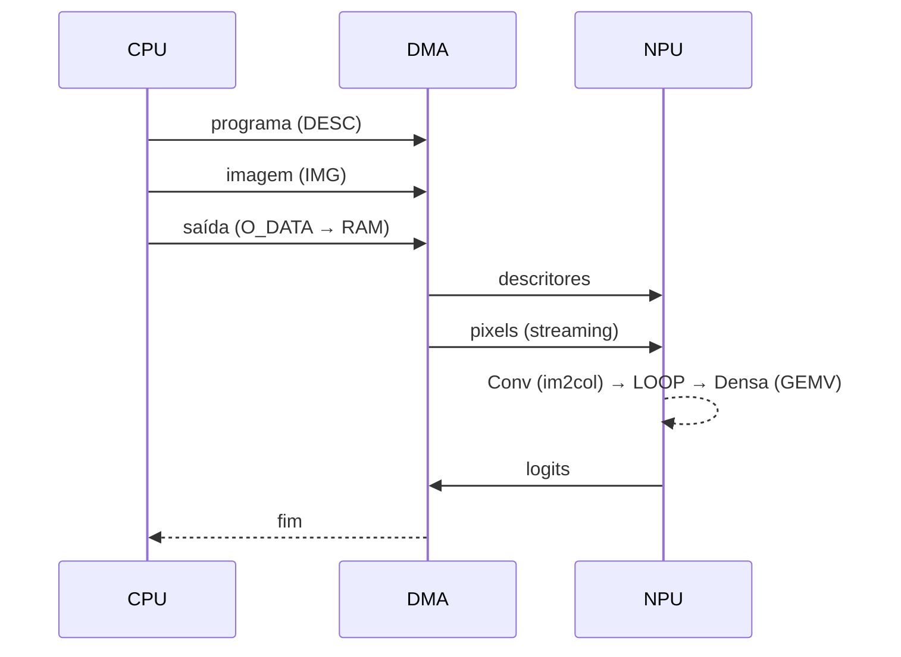

# Movimentação de Dados e Autonomia

Num SoC com uma CPU RV32I multiciclo e uma RAM principal compartilhada, o gargalo de uma NPU não é o arranjo de PEs, e sim o caminho de **Von Neumann** entre a RAM e o acelerador: cada peso, cada ativação, cada resultado e cada escrita de configuração passa pelo mesmo barramento, e boa parte disso era feita pela própria CPU. Medido na placa, o arranjo 4x4 (16 MACs/ciclo de pico) ficava ocioso a maior parte do tempo.

Esta página descreve os mecanismos que levam a NPU a buscar, gerar e reaproveitar os seus próprios dados, tirando a CPU do caminho crítico. A programação de cada um está na [API de Programação](../software/api_programming.md).

!!! abstract "Princípio"
    Cada mecanismo ataca um dos tráfegos do barramento: **dados que não mudam** passam a morar na NPU, **dados que podem ser gerados** são gerados lá dentro, **dados que precisam trafegar** trafegam por DMA em paralelo com o cômputo, e **o controle** deixa de ser feito pela CPU.

## 1. Dados residentes

### Pesos residentes (`W_BASE` / `I_BASE`)

Os pesos de uma rede treinada não mudam entre inferências. Os registradores de base dividem as RAMs locais em regiões: cada camada ocupa a sua região da RAM de pesos e é carregada **uma única vez**, na carga do modelo. A cada inferência, só as ativações trafegam.

### Biases residentes

O banco de bias tem 8 vetores de 4 colunas (`BIAS_TILES = 8`). O campo `TILES[21:19]` escolhe o banco do primeiro tile de uma execução, de modo que cada camada usa os seus próprios bancos (ex.: Conv no banco 3, densa nos bancos 0..2), gravados uma vez na carga do modelo.

## 2. Dados gerados dentro da NPU

### im2col em hardware (`npu_im2col`)

Numa convolução, as janelas (im2col) repetem cada pixel até `KW x KH` vezes. Em vez de a CPU desdobrar a imagem e enviar as janelas, a NPU recebe a imagem **crua** pela porta `IMG` e monta as janelas sozinha:

- a imagem é guardada em 4 cópias, uma por linha do arranjo, para que as 4 linhas leiam pixels de janelas diferentes no mesmo ciclo;
- o endereçamento é guiado pelas leituras emitidas pelo Controller (geometria em `IM2COL_GEOM`: largura da entrada, janelas por linha, passo e largura do kernel);
- o tráfego da camada cai do tamanho das janelas para o tamanho da imagem.

### Fusão de camadas (`OUT_CFG.LOOP`)

A saída da PPU é escrita na RAM de Inputs (a partir de `I_BASE`) em vez da FIFO. A camada seguinte lê dali, sem passar pela RAM principal. Na CNN do projeto, a saída da Conv (4 canais por palavra) é exatamente a entrada da densa em modo GEMV.

## 3. Uso pleno do arranjo

### Sequenciador de tiles (`TILES`)

Um único START executa `N` tiles. A cada tile, os ponteiros de leitura podem voltar às bases (`RW_W`: os mesmos pesos para várias janelas, como numa convolução; `RW_I`: as mesmas entradas para vários blocos de neurônios, como numa densa). Os acumuladores se zeram no drain de cada tile e o drain só começa quando o tile cabe na FIFO. O formatador de saída (`OUT_CFG.ORDER`/`UNPACK`) entrega as linhas em ordem e, se preciso, uma ativação por palavra.

### Modo GEMV (`MODE.GEMV`)

Com uma única amostra, a densa é um produto matriz-vetor e só usaria 1 das 4 linhas do arranjo. No modo GEMV:

- a linha `r` acumula as features `k ≡ r (mod 4)` e a coluna `c` o neurônio `4j + c`;
- cada PE recebe o seu próprio peso a cada ciclo, lido de uma memória de pesos em **4 bancos** (`wgt_mem_banked`), com o atraso `r + c` da propagação sistólica;
- as 4 somas parciais de cada coluna são reduzidas antes da PPU, que entrega uma palavra por bloco de 4 neurônios;
- com `BIAS_PER_TILE`, cada bloco usa o seu vetor de bias, e a densa inteira roda num único START.

### Tiles encadeados (`MODE.OVERLAP`)

Sem encadeamento, o arranjo esvazia entre um tile e o seguinte (preenchimento e drain do pipeline sistólico). Com `OVERLAP`:

- cada PE copia o resultado do tile que terminou para um **acumulador sombra** e recomeça do zero no mesmo ciclo;
- a marca de fim de tile viaja junto com as ativações; ao sair pela borda direita da linha `r`, dispara a leitura daquela linha;
- o retorno dos ponteiros (`RW_W`/`RW_I`) é aplicado na emissão seguinte, sem bolhas.

## 4. Dados que trafegam em paralelo com o cômputo

### Streaming (`MODE.STREAM_I` / `STREAM_W`)

O START pode vir **antes** da carga dos dados. O Controller só emite uma leitura quando o seu dado já foi escrito (ponteiro de leitura atrás do de escrita; no im2col, todos os pixels do tap corrente já recebidos). O DMA da carga corre então em paralelo com o cômputo: a Conv começa a calcular enquanto a imagem ainda chega.

### Saída por DMA

Enquanto a NPU está ocupada, uma leitura de `O_DATA` com a FIFO vazia segura o barramento até chegar o próximo resultado. Assim, um DMA em modo de origem fixa drena a saída para a RAM em paralelo com o cômputo, sem consultar o status. A FIFO de saída tem 256 palavras.

## 5. Controle sem a CPU: descritores de camada (`npu_cmd_proc`)

Com os dados resolvidos, o custo passou a ser o **controle**: dezenas de escritas MMIO de configuração por camada, cada uma custando dezenas de ciclos de instruções da CPU. O processador de comandos executa um **programa de configuração** recebido pela porta `DESC`:

```text
WRITE  0x1000_00rr  <dado>     # escreve o registrador de offset rr (inclusive CMD/START)
WAIT   0x2000_0000             # espera a execução do último START terminar
END    0x3000_0000             # fim do programa (STATUS bit 4)
```

- O programa da rede inteira é montado **uma vez** na RAM e enviado por DMA a cada inferência; a fila tem 128 palavras e, cheia, segura o barramento (nada se perde).
- Durante um programa, escritas de configuração pelo barramento esperam o fim do programa; as portas de dados (`W`, `I`, `IMG`, `O_DATA`) continuam livres.
- `O_DATA` também segura o barramento enquanto o programa executa, então a saída pode ser lida sem consultar o status.



## 6. Resultado

CNN do projeto (Conv 3x3/passo 2 com 4 filtros + densa 676→10), por imagem, na Nexys A7-100T a 100 MHz, com a CPU compilada em `-O2` e logits bit a bit idênticos à emulação:

| Configuração | Ciclos por imagem | MACs úteis/ciclo |
| --- | ---: | ---: |
| CPU fazendo im2col e controle, sem os mecanismos | 226.417 | 0,06 |
| Todos os mecanismos | **1.506** | **8,5** |

- No benchmark sintético do SoC, a NPU atinge **12,2 MACs/ciclo** (76% do pico) em GEMM e até 14,4 MACs/ciclo em convoluções com kernels maiores.
- A transferência de dados por DMA é **14,7x** mais rápida que por PIO.
- Recursos (Nexys A7-100T, SoC completo): 107,5 de 135 BRAM36, ~11 mil LUTs, timing fechado a 100 MHz.

!!! info "Retrocompatibilidade"
    Todos os registradores novos valem zero após o reset, o que reproduz o comportamento original: software que não os usa continua funcionando sem alterações.
