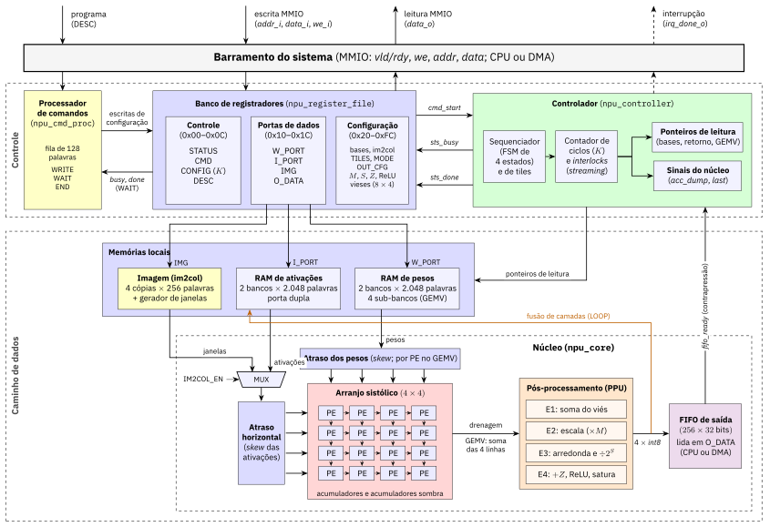

# Unidade de Processamento Neural (NPU)

A **NPU** é um acelerador de inferência de redes neurais escrito em **VHDL-2008**: um arranjo sistólico $4\times4$ de precisão **INT8**, com fluxo de dados *Output Stationary* e um modo GEMV (produto matriz-vetor) para camadas densas. Ela foi desenvolvida como coprocessador do [SoC RISC-V](https://github.com/RISC-V-Azedinha/RISC-V) do projeto RISC-V-Azedinha e também pode ser testada isoladamente na FPGA, controlada por um computador via UART.

<figure class="ax-figura" markdown>
  { width="760" }
  <figcaption>Arquitetura da NPU (<code>npu_top.vhd</code>): o plano de controle decodifica os acessos MMIO, executa os programas de descritores e sequencia as passagens; o caminho de dados leva os operandos das memórias locais ao arranjo e os resultados, pela PPU, à FIFO de saída.</figcaption>
</figure>

## Motivação

Em redes neurais, o custo da inferência é dominado por uma única operação, a **multiplicação e acumulação** (MAC), $\mathit{acc}\leftarrow\mathit{acc}+a\cdot w$. Um processador de uso geral faz uma MAC por vez e gasta várias instruções em cada uma; no núcleo RV32I multiciclo do SoC, que não tem instrução de multiplicação, são dezenas de ciclos por MAC. Aceleradores dedicados fazem muitas MACs em paralelo e, sobretudo, **reaproveitam os dados já lidos da memória**, porque mover um dado custa mais tempo e energia do que operar sobre ele (o *memory wall*).

A organização clássica para isso é o **arranjo sistólico**, presente em aceleradores como a TPU do Google: uma grade de elementos de processamento (PEs) que passam dados aos vizinhos a cada ciclo, de modo que cada valor lido da memória é usado por uma linha ou coluna inteira de PEs. O uso de inteiros de 8 bits no lugar de ponto flutuante reduz ainda mais o custo de armazenar e mover os dados.

Num SoC em que CPU, memória e acelerador dividem um único barramento, porém, o arranjo só calcula enquanto recebe dados. Por isso, além do núcleo de cálculo, a NPU reúne **mecanismos de movimentação de dados e de controle** que tiram a CPU do caminho crítico: pesos residentes, *im2col* em hardware, *streaming*, fusão de camadas e um processador de comandos que executa a rede inteira a partir de um programa enviado por DMA.

## Destaques

| Item | Valor |
|---|---|
| Arranjo | $4\times4$ PEs, *Output Stationary*, modo GEMV para camadas densas |
| Precisão | entradas e pesos INT8; acumuladores INT32 |
| Pós-processamento | viés, escala $M$, deslocamento $S$ com arredondamento, ponto zero, ReLU e saturação |
| Vazão máxima (GEMM, $K=2048$) | 12,2 MACs úteis/ciclo, 76% do teto de 16 |
| Aceleração sobre o RV32I | 7.477× no mesmo produto de matrizes |
| CNN para o MNIST (12.844 MACs) | 1.506 ciclos por inferência (15 µs a 100 MHz) |
| Acurácia da CNN em INT8 | 97,79% (emulação bit a bit, 10.000 imagens de teste) |
| Plataforma | Digilent Nexys A7-100T (Xilinx Artix-7), 100 MHz |

## Organização desta documentação

1. **[Primeiros passos](primeiros-passos.md):** ferramentas, simulação e execução na FPGA.
2. **[Fundamentos](fundamentos.md):** o muro da memória, redes neurais, quantização para inteiros e arranjos sistólicos.
3. **Arquitetura:** [visão geral e integração ao SoC](arquitetura/visao-geral.md), [núcleo de cálculo](arquitetura/nucleo.md) (PE, arranjo e PPU), [memórias e controle](arquitetura/memorias-controle.md) (controlador e processador de comandos) e [movimentação de dados](arquitetura/movimentacao-dados.md).
4. **[Mapeamento de camadas](mapeamento.md):** como o arranjo calcula, a convolução e a camada densa no modo GEMV, com exemplos numéricos ciclo a ciclo.
5. **[Software](software.md):** mapa de registradores, programação de cada mecanismo e *hardware-in-the-loop*.
6. **Avaliação:** [desempenho da NPU](avaliacao/desempenho.md), com a metodologia, o [benchmark dos mecanismos](avaliacao/benchmark-mecanismos.md), com a ablação de cada um, e o [estudo de caso da CNN para o MNIST](avaliacao/cnn-mnist.md).
7. **[Desenvolvimento](desenvolvimento.md):** simulação com Cocotb e síntese em FPGA.
8. **Aplicações:** redes para os conjuntos [Iris](aplicacoes/iris.md) e [MNIST](aplicacoes/mnist.md).

## Estrutura do repositório

```text
NPU/
├── rtl/        # Código VHDL: núcleo, PPU, memórias, im2col, controle e processador de comandos
│   └── fpga_tester/   # Top-level de teste na FPGA (UART + processador de comandos do host)
├── pkg/        # Pacotes VHDL compartilhados
├── sim/        # Testbenches em Python (Cocotb)
├── sw/         # Drivers do hospedeiro e aplicações (HIL)
├── fpga/       # Restrições (XDC) e scripts TCL do Vivado
├── mk/         # Regras modulares do makefile
└── docs/       # Esta documentação (MkDocs)
```
