# Mapeamento de camadas

Mapear uma camada no arranjo envolve duas perguntas diferentes. A primeira é **como** o arranjo calcula: o mecanismo é sempre o mesmo e é apresentado primeiro, em um arranjo $2\times2$ com números pequenos. A segunda é **o que** colocar em cada linha e em cada coluna, e é aí que a [convolução](#convolucao) e a [camada densa](#camada-densa-e-modo-gemv) diferem. Para simplificar as contas, os exemplos omitem o viés e a divisão da PPU, que só reescalam o resultado.

## Como o arranjo calcula

### A ideia central

> **Cada linha do arranjo recebe um vetor de entrada, cada coluna recebe um vetor de pesos, e cada PE calcula o produto escalar entre o vetor da sua linha e o vetor da sua coluna.**

No arranjo $2\times2$ da figura, as linhas recebem $\mathbf a_0=(1,2,3)$ e $\mathbf a_1=(2,1,1)$, e as colunas recebem $\mathbf w_0=(1,2,1)$ e $\mathbf w_1=(2,1,3)$. Ao final, o PE$_{00}$ deve conter $\mathbf a_0\cdot\mathbf w_0=1\cdot1+2\cdot2+3\cdot1=8$; o PE$_{01}$, $\mathbf a_0\cdot\mathbf w_1=13$; o PE$_{10}$, $\mathbf a_1\cdot\mathbf w_0=5$; e o PE$_{11}$, $\mathbf a_1\cdot\mathbf w_1=8$.

<figure class="ax-figura" markdown>
  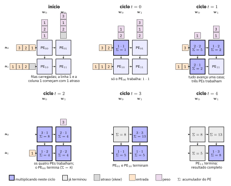{ width="720" }
  <figcaption>Funcionamento do arranjo sistólico, ciclo a ciclo, em um arranjo \(2\times2\). As entradas (laranja) andam para a direita e os pesos (lilás), para baixo, uma casa por ciclo. Em cada ciclo, os PEs em azul multiplicam o par de valores que acabaram de receber e somam o produto ao seu acumulador \(\Sigma\).</figcaption>
</figure>

### Ciclo a ciclo

Os valores esperam em filas, com o primeiro elemento de cada vetor na ponta, junto ao arranjo. A cada ciclo, cada PE faz duas coisas: multiplica o par que está recebendo e soma o produto ao acumulador $\Sigma$; e repassa a entrada ao vizinho da direita e o peso ao vizinho de baixo. Seguindo a figura:

- **Início:** a linha 1 e a coluna 1 começam com uma casa vazia, o atraso (*skew*), cuja razão aparece no ciclo 1.
- **Ciclo 0:** só o PE$_{00}$ tem os dois operandos; ele calcula $1\cdot1$, e $\Sigma=1$.
- **Ciclo 1:** tudo anda uma casa. O PE$_{00}$ recebe o segundo par ($2\cdot2$, $\Sigma=5$). O PE$_{01}$ recebe a entrada 1 que o PE$_{00}$ acabou de repassar e o primeiro peso de $\mathbf w_1$ ($1\cdot2$). O PE$_{10}$ recebe o peso 1 que desceu do PE$_{00}$ e, no mesmo ciclo, o primeiro elemento de $\mathbf a_1$, que esperou um ciclo na casa de atraso ($2\cdot1$). Sem o atraso, esse 2 teria chegado no ciclo 0, antes do peso com que deve ser multiplicado.
- **Ciclo 2:** os quatro PEs trabalham, e o PE$_{00}$ faz sua última multiplicação: $\Sigma=8$.
- **Ciclos 3 e 4:** os PEs mais afastados terminam; o último é o PE$_{11}$, no ciclo 4.

Ao final, os acumuladores contêm exatamente os quatro produtos escalares esperados. As entradas e os pesos atravessam o arranjo, mas cada resultado fica parado no seu PE do começo ao fim: é o fluxo **estacionário na saída**.

### A frente de onda

Em geral, o elemento $k$ do vetor da linha $i$ encontra o elemento $k$ do vetor da coluna $j$ no PE$_{ij}$ no ciclo

$$
t=k+i+j.
$$

No arranjo real, $4\times4$, nada muda além do tamanho: são quatro vetores de entrada e quatro de pesos, com $K$ elementos cada, e a última multiplicação ocorre no ciclo $(K-1)+3+3$. No hardware, as filas são as duas memórias locais da NPU: a cada ciclo, uma palavra de 32 bits da memória de entradas fornece um elemento para cada linha (o byte $i$ vai para a linha $i$), e uma palavra da memória de pesos, um elemento para cada coluna (o byte $j$ vai para a coluna $j$).

## Convolução

O exemplo usa uma imagem $5\times5$ com um traço diagonal e quatro filtros $3\times3$ com papéis fáceis de reconhecer: borda vertical (F0), borda horizontal (F1) e as duas diagonais (F2 e F3). Antes de ir ao arranjo, vejamos qual conta precisa ser feita.

### A conta

Com passo $s=2$ e sem o viés, a saída do filtro $c$ na posição $(u,v)$ é

$$
Y^{(c)}_{u,v}=\sum_{m=0}^{2}\sum_{n=0}^{2}K^{(c)}_{m,n}\,X_{2u+m,\;2v+n}:
$$

coloca-se o filtro sobre a janela de $3\times3$ pixels que começa em $(2u,2v)$, multiplicam-se os valores sobrepostos e somam-se os 9 produtos. Com $5\times5$ pixels e passo 2, há $2\times2$ posições, ou seja, quatro janelas, J0 a J3. Elas se sobrepõem na linha e na coluna centrais da imagem, porque o passo (2) é menor que o lado do filtro (3).

<figure class="ax-figura" markdown>
  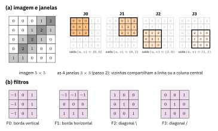{ width="700" }
  <figcaption>Exemplo reduzido da convolução. (a) Imagem \(5\times5\) e as quatro janelas \(3\times3\) de passo 2, cada uma destacada em uma miniatura. (b) Os quatro filtros.</figcaption>
</figure>

Vale fazer uma dessas contas à mão. Para a janela J1, na posição $(u,v)=(0,1)$, com o filtro F3, da diagonal "/":

$$
Y^{(3)}_{0,1}=\underbrace{0\cdot0+0\cdot1+1\cdot2}_{\text{linha 0}}
             +\underbrace{0\cdot1+1\cdot2+0\cdot1}_{\text{linha 1}}
             +\underbrace{1\cdot2+0\cdot1+0\cdot0}_{\text{linha 2}}=6.
$$

O filtro só "enxerga" os três pixels da diagonal "/" da janela, e o resultado é alto porque o traço passa justamente por eles. Repetindo a conta para as quatro janelas e os quatro filtros, obtêm-se 16 saídas. **São esses 16 números que o arranjo precisa produzir.**

<figure class="ax-figura" markdown>
  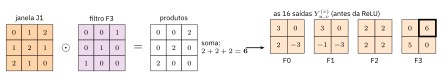{ width="780" }
  <figcaption>Cálculo manual de uma saída: os pixels da janela J1 são multiplicados, um a um, pelos pesos do filtro F3, e os produtos são somados. À direita, as 16 saídas do exemplo, organizadas em quatro mapas \(2\times2\); o contorno grosso marca a saída calculada.</figcaption>
</figure>

### A convolução como produto de matrizes (*im2col*)

Para chegar ao arranjo, falta escrever a mesma conta como um produto de matrizes. A soma dupla é, na verdade, um produto escalar entre 9 pixels e 9 pesos: basta achatar a janela e o filtro, linha a linha, em vetores de 9 elementos. É o que faz a técnica ***im2col***: cada janela vira uma linha da matriz $\mathbf P$ ($4\times9$), e cada filtro, uma coluna da matriz $\tilde{\mathbf K}^{\top}$ ($9\times4$). As 16 saídas formam o produto

$$
\mathbf C=\mathbf P\,\tilde{\mathbf K}^{\top},\qquad
c_{ij}=\sum_{k=0}^{8}P_{i,k}\,\tilde K^{(j)}_{k}=(\text{janela J}i)\cdot(\text{filtro F}j).
$$

A saída calculada à mão é o elemento $c_{13}$: a linha de J1 vezes a coluna de F3. Comparando com o [mecanismo do arranjo](#como-o-arranjo-calcula), cada $c_{ij}$ é exatamente o produto escalar que o PE$_{ij}$ calcula. A alocação sai daí: **a janela $i$ vai para a linha $i$ do arranjo, e o filtro $j$, para a coluna $j$**. Como há quatro janelas e quatro filtros, a convolução inteira cabe em uma única passagem.

<figure class="ax-figura" markdown>
  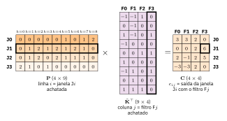{ width="620" }
  <figcaption>A convolução do exemplo como produto de matrizes. Cada linha de \(\mathbf P\) é uma janela achatada, e cada coluna de \(\tilde{\mathbf K}^{\top}\), um filtro achatado; os contornos grossos mostram que \(c_{13}=6\) é a linha de J1 vezes a coluna de F3.</figcaption>
</figure>

### Entrada dos dados no arranjo

Resta levar esse produto ao arranjo, aplicando o mecanismo com quatro linhas, quatro colunas e $K=9$: a linha $i$ recebe a linha $i$ de $\mathbf P$ (os 9 pixels da janela J$i$), e a coluna $j$, a coluna $j$ de $\tilde{\mathbf K}^{\top}$ (os 9 pesos do filtro F$j$), com os mesmos atrasos de $i$ e $j$ casas. Na memória, cada palavra de 32 bits é uma "fatia" das quatro filas: a palavra $k$ das entradas junta o pixel $k$ das quatro janelas, e a palavra $k$ dos pesos, o peso $k$ dos quatro filtros. A primeira palavra de entradas é $(0,0,0,2)$, e a primeira de pesos, $(-1,-1,1,0)$.

<figure class="ax-figura" markdown>
  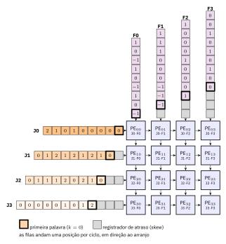{ width="520" }
  <figcaption>Entrada dos dados no arranjo. Cada linha recebe os 9 pixels de uma janela e cada coluna, os 9 pesos de um filtro, com o pixel e o peso \(k=0\) mais próximos do arranjo. Os registradores de atraso (cinza) fazem a linha \(i\) e a coluna \(j\) começarem \(i\) e \(j\) ciclos depois.</figcaption>
</figure>

### O cálculo

Com os dados nas filas, o cálculo avança em diagonal, seguindo a frente de onda $t=k+i+j$. No ciclo 0, só o PE$_{00}$ trabalha; entre os ciclos 6 e 8, os 16 PEs trabalham ao mesmo tempo, cada um em um passo $k$ diferente; e no ciclo $8+3+3=14$ o PE$_{33}$ faz o último produto. Cada PE executa as 9 multiplicações do seu par janela-filtro; o PE$_{13}$, por exemplo, refaz a conta manual, um produto por ciclo, entre os ciclos 4 e 12, e termina com $\Sigma=6$.

<figure class="ax-figura" markdown>
  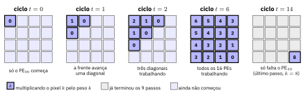{ width="780" }
  <figcaption>O cálculo da convolução do exemplo (\(K=9\)) em cinco instantes. O número em cada PE em destaque é o passo \(k=t-i-j\) que ele executa naquele ciclo.</figcaption>
</figure>

### A saída

Ao fim da passagem, o arranjo contém a matriz $\mathbf C$. A PPU zera os valores negativos (ReLU), e os acumuladores descem para a saída uma linha por vez; por padrão, a partir da linha 3, mas o formatador de saída da NPU pode entregá-las na ordem 0 a 3. Cada palavra traz, portanto, os quatro filtros de uma mesma janela, e as palavras gravadas em sequência formam o vetor de ativações já na ordem **NHWC** (os quatro canais de cada posição juntos), que é a ordem em que a camada densa seguinte espera os dados.

<figure class="ax-figura" markdown>
  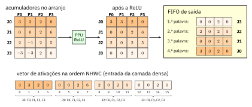{ width="740" }
  <figcaption>Saída da passagem do exemplo: acumuladores, ReLU na PPU, ordem de drenagem (linha 3 primeiro) e o vetor resultante na ordem NHWC, que alimenta a camada densa.</figcaption>
</figure>

## Camada densa e modo GEMV

### A conta

Na camada densa, cada neurônio está ligado a todas as entradas. O exemplo tem 5 entradas e 6 neurônios: cada uma das 5 ativações $\tilde a_k$ chega a cada um dos 6 neurônios por uma ligação com peso próprio, num total de 30 pesos. Cada neurônio multiplica cada entrada pelo peso da ligação por onde ela chega e soma os produtos. Para o neurônio N0, cujos pesos são $1$, $-1$, $0$, $2$ e $1$:

$$
z_0=1\cdot2+(-1)\cdot0+0\cdot1+2\cdot3+1\cdot1=9.
$$

<figure class="ax-figura" markdown>
  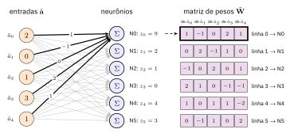{ width="700" }
  <figcaption>A camada densa do exemplo vista como rede. As ligações que chegam ao neurônio N0 aparecem em destaque, com seus pesos. Guardando, para cada neurônio, os pesos das ligações que chegam a ele, obtém-se uma linha da matriz \(\tilde{\mathbf W}\).</figcaption>
</figure>

Para fazer a conta de todos os neurônios de uma vez, os pesos que chegam ao neurônio $n$ formam a linha $n$ de uma matriz $\tilde{\mathbf W}$, e a camada inteira é um produto de matriz por vetor:

$$
\mathbf z=\tilde{\mathbf W}\,\tilde{\mathbf a},\qquad z_n=\sum_{k=0}^{K-1}\tilde W_{n,k}\,\tilde a_k .
$$

No exemplo, com $K=5$ entradas e 6 neurônios, sem o viés:

$$
\underbrace{\begin{bmatrix}
   1&-1& 0& 2& 1\\
   0& 2&-1& 1& 0\\
  -1& 0& 2& 0& 1\\
   2& 1& 0&-1&-1\\
   1& 0& 1& 1&-2\\
   0&-1& 1& 0& 2
\end{bmatrix}}_{\tilde{\mathbf W}\ (6\times5)}
\underbrace{\begin{bmatrix}2\\0\\1\\3\\1\end{bmatrix}}_{\tilde{\mathbf a}}
=\underbrace{\begin{bmatrix}9\\2\\1\\0\\4\\3\end{bmatrix}}_{\mathbf z}.
$$

Cada $z_n$ é, de novo, um produto escalar, agora entre o vetor de entradas e o vetor de pesos do neurônio $n$. Pelo [mecanismo do arranjo](#como-o-arranjo-calcula), isso indica a alocação das colunas: **os pesos do neurônio $n$ ocupam uma coluna do arranjo**. Como há quatro colunas, os neurônios são processados de quatro em quatro, um bloco por passagem: $\mathbf z_{0..3}$ na primeira e $\mathbf z_{4..5}$ na segunda, completada com dois neurônios nulos.

<figure class="ax-figura" markdown>
  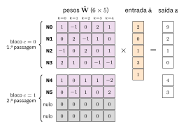{ width="440" }
  <figcaption>Divisão do produto em passagens. Como o arranjo tem quatro colunas, os neurônios são agrupados de quatro em quatro; o último bloco é completado com neurônios nulos. As entradas são as mesmas nas duas passagens.</figcaption>
</figure>

### Modo GEMV

A diferença em relação à convolução está nas linhas, e vale construí-la por etapas.

**Primeira tentativa: uma linha só.** Na convolução, cada linha do arranjo recebe uma janela diferente. Na camada densa, com uma imagem por vez, só existe **um** vetor de entradas. A alocação direta seria colocá-lo na linha 0, com um neurônio em cada coluna. Funciona, mas as linhas 1 a 3 não teriam o que fazer: 12 dos 16 PEs multiplicariam zeros, e a passagem levaria um passo por entrada.

**A ideia: dividir a soma entre as linhas.** A conta de cada neurônio é uma soma de produtos, e uma soma pode ser quebrada em pedaços e juntada no fim. Para $z_0$:

$$
z_0=\underbrace{1\cdot2+1\cdot1}_{\text{linha 0: entradas 0 e 4}}
   +\underbrace{(-1)\cdot0}_{\text{linha 1: entrada 1}}
   +\underbrace{0\cdot1}_{\text{linha 2: entrada 2}}
   +\underbrace{2\cdot3}_{\text{linha 3: entrada 3}}
   =3+0+0+6=9.
$$

É o que faz o modo de produto matriz-vetor (**GEMV**) da NPU: **o vetor de entradas é repartido entre as quatro linhas, e cada PE acumula um pedaço do produto escalar do neurônio da sua coluna**. A linha $i$ recebe as entradas $k\equiv i\pmod 4$, isto é, $\tilde a_i,\tilde a_{i+4},\tilde a_{i+8},\dots$ As colunas não mudam: cada coluna continua sendo um neurônio. Como as quatro linhas trabalham ao mesmo tempo, a passagem do exemplo leva 2 passos em vez de 5. Ao fim dela, o PE$_{ij}$ guarda uma **soma parcial** $s_{ij}$, e o neurônio completo é a soma da sua coluna, feita pela NPU antes da PPU:

$$
s_{ij}=\sum_{t}\tilde W_{j,\,4t+i}\;\tilde a_{4t+i},\qquad z_j=\sum_{i=0}^{3}s_{ij}.
$$

**Por que os pesos não descem mais pela coluna.** Na convolução, todos os PEs de uma coluna usam o **mesmo** peso no mesmo passo, pois é o mesmo filtro aplicado a janelas diferentes; por isso o peso entra pelo topo e desce de PE em PE. No GEMV, isso deixa de valer: no primeiro passo da coluna N0, o PE$_{00}$ multiplica a entrada 0 e precisa do peso $\tilde W_{0,0}=1$; o PE$_{10}$ multiplica a entrada 1 e precisa de $\tilde W_{0,1}=-1$; e assim por diante. Cada PE da coluna precisa de um peso **diferente**. Por isso, a memória de pesos é dividida em quatro bancos, que entregam 16 pesos de uma vez a cada passo, um para cada PE, e um multiplexador em cada PE escolhe esse peso próprio no lugar do que vem de cima. A ligação vertical continua existindo no hardware, pois a convolução a usa, mas é ignorada neste modo.

### Entrada dos dados no modo GEMV

As 5 entradas, completadas com zeros até 8, cabem em dois passos ($t=0$ e $t=1$). Na memória de entradas, a palavra $t$ traz as entradas $4t$ a $4t+3$, e o byte $i$ vai para a linha $i$. Nos pesos, o banco $i$ guarda, no passo $t$, a palavra da entrada $k=4t+i$, com o peso do neurônio N$j$ no byte $j$: o PE$_{ij}$ recebe o byte $j$ do banco $i$. Resta acertar o tempo: a entrada $\tilde a_{4t+i}$ começa $i$ ciclos atrasada e leva mais $j$ ciclos para andar até a coluna $j$; por isso, o peso do PE$_{ij}$ também é atrasado em $i+j$ ciclos, e os dois se encontram no ciclo $t+i+j$, a mesma frente de onda da convolução.

<figure class="ax-figura" markdown>
  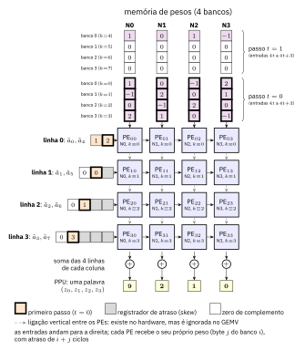{ width="560" }
  <figcaption>Entrada dos dados na primeira passagem do exemplo, no modo GEMV. A linha \(i\) recebe as entradas \(k=i\) e \(k=i+4\). A memória de pesos entrega um bloco \(4\times4\) por passo: o PE\(_{ij}\) recebe o byte \(j\) do banco \(i\), com atraso de \(i+j\) ciclos; a ligação vertical (tracejada) é ignorada neste modo.</figcaption>
</figure>

Ao fim da passagem, cada PE contém uma soma parcial. Na coluna do neurônio N0, o PE$_{00}$ acumula $1\cdot2+1\cdot1=3$; o PE$_{10}$, $(-1)\cdot0=0$; o PE$_{20}$, $0\cdot1=0$; e o PE$_{30}$, $2\cdot3=6$. A soma da coluna, $3+0+0+6=9$, é exatamente $z_0$. As outras colunas dão $z_1=2$, $z_2=1$ e $z_3=0$, e a PPU entrega os quatro numa única palavra. Na segunda passagem, a NPU relê as mesmas entradas, e as colunas recebem os pesos de N4, N5 e dos dois neurônios nulos, produzindo $z_4=4$ e $z_5=3$.

<figure class="ax-figura" markdown>
  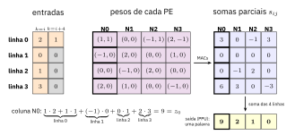{ width="680" }
  <figcaption>Primeira passagem da camada densa do exemplo no modo GEMV. Cada PE acumula uma soma parcial \(s_{ij}\); as quatro linhas de cada coluna são somadas, e a PPU entrega os quatro neurônios do bloco numa única palavra. O contorno grosso acompanha o neurônio N0.</figcaption>
</figure>

Com essa alocação, os 16 PEs trabalham também na camada densa, e cada passagem leva $\lceil K/4\rceil$ passos em vez de $K$. Na memória, a palavra $t$ de entradas traz as entradas $4t$ a $4t+3$, uma por byte, o mesmo formato em que a convolução entrega as suas saídas: **a saída de uma camada já é a entrada da outra**.

### O fluxo de dados no modo GEMV

Essa divisão muda a classificação do fluxo de dados. Na taxonomia usual, um fluxo é caracterizado pelo dado que permanece no PE e pelo modo como os demais são reaproveitados. No modo GEMV:

- as **somas parciais** continuam estacionárias, como na convolução: cada PE acumula localmente do primeiro ao último passo;
- o **resultado final** $z_j$, porém, não fica em um único PE: ele é repartido entre os quatro PEs da coluna e só se forma na soma feita fora do arranjo;
- as **entradas** continuam sistólicas, andando para a direita e servindo aos quatro neurônios da linha;
- os **pesos** não são reaproveitados: com uma única imagem, cada peso de uma camada densa é usado exatamente uma vez, e o que limita o arranjo é a banda da memória de pesos, que precisa entregar 16 pesos por ciclo.

O modo GEMV é, portanto, uma variação híbrida do fluxo estacionário na saída: estacionário nas somas parciais, sistólico nas entradas, sem reuso dos pesos e com uma redução espacial ao final. A convolução, em que todos esses reusos existem, continua usando o fluxo estacionário na saída puro.

## Da ilustração à rede real

Na rede real, cada camada repete os exemplos com dimensões maiores. A imagem $28\times28$ tem 169 janelas, que, completadas com três janelas nulas, formam 43 grupos de quatro; cada grupo é uma passagem idêntica à do exemplo da convolução, com os mesmos 9 pesos e quatro janelas novas. A camada densa tem 676 entradas e 10 neurônios e roda no modo GEMV: três passagens de $676/4=169$ passos, a última com dois neurônios nulos. Na NPU, as janelas da convolução nunca são gravadas: o [*im2col* em hardware](arquitetura/movimentacao-dados.md#im2col-em-hardware-npu_im2col) monta cada palavra de entrada a partir da imagem crua, no momento da leitura.

| | Convolução | Camada densa |
|---|:---:|:---:|
| Linha $i$ recebe | janela $4g+i$ | entradas $k\equiv i \pmod 4$ |
| Coluna $j$ recebe | filtro $j$ | neurônio $4c+j$ |
| Passos por passagem | 9 | 169 |
| Passagens | 43 | 3 |
| Relido a cada passagem | pesos | entradas |
| MACs úteis | 98% | 83% |

Das $3\cdot169\cdot16=8.112$ MACs que o arranjo executa na camada densa, 6.760 são úteis, cerca de 83%; com a entrada ocupando uma única linha, seriam 32.448 MACs, das quais 21% úteis.

Como o *firmware* alimenta a NPU com essas camadas, com pesos residentes, *im2col* em hardware e o programa de descritores, está no [estudo de caso](avaliacao/cnn-mnist.md#execucao-no-soc).
